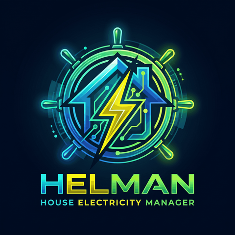
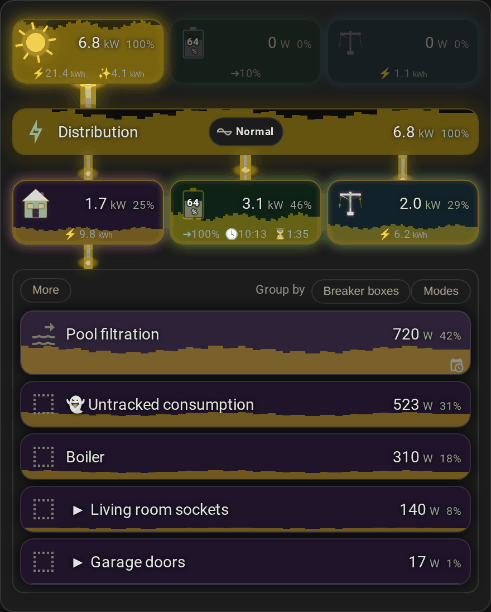
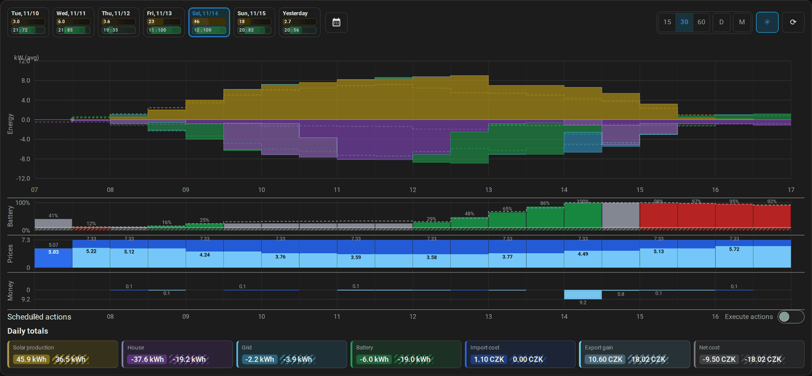
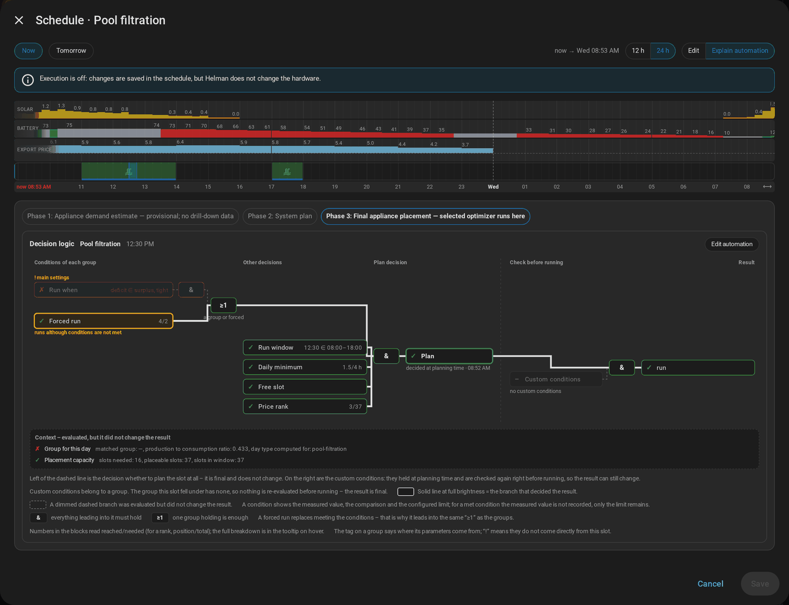

  

  <b>Solar, battery and appliances, planned 48 hours ahead and run by Home Assistant.</b> 
  <a href="https://scarfsail.github.io/hass-helman/">Manual</a> ·
  <a href="https://scarfsail.github.io/hass-helman/getting-started/">Getting started</a> ·
  <a href="https://scarfsail.github.io/hass-helman/automation/recipes/">Recipes</a>

---

Helman is a Home Assistant integration for houses with solar panels and a home battery. It learns what your roof produces and what your household consumes, plans the next 48 hours in 15-minute slots, and drives your inverter and appliances by that plan. When a plan changes, Helman can show you why.

## The problem it solves

A battery on its default setting fills at dawn and runs empty after dark. Appliances run on timers set months ago. The result:

- **You sell cheap and store expensive.** The battery fills from morning sun that would have sold well, and the cheap noon surplus is what gets exported.
- **You buy at the peak.** On a short day the battery is empty by the afternoon, and the evening runs on the most expensive grid hours.
- **An outage finds the battery empty.**
- **The pool pump runs at 10:00 on a grey day** and stays off on a bright evening.

Helman replaces fixed rules with a plan built from tomorrow's forecast, your tariff and the day-ahead export prices.

## What it does

<table>
<tr>
<td width="50%" valign="top">

**See where every watt goes.** Live solar, battery, grid and house power, with the house broken down into a tree of devices, breakers and sockets. The consumption no meter explains has its own row.

**Power for devices without a meter.** Helman bundles a device's switch, meter and power sensor into one *Helman device*. A light or TV with only a switch, sitting on a metered circuit, gets its own power, energy, runs and cost: Helman learns each device's draw from the circuit's history.

</td>
<td width="50%" valign="top">

</td>
</tr>
</table>

**Forecasts you can trust.** Your solar forecast is corrected for the repeating errors of your own roof (a tree at 8:30, an optimistic provider) and scaled live as the day unfolds. Household consumption is learned per hour of the week. A battery projection follows every planned action.

**A 48-hour plan that acts.** You describe goals and optimizers turn them into actions, slot by slot:

| Goal | Optimizer |
| --- | --- |
| Fill the battery from the cheapest export slots and sell the dear ones | Charge hold |
| Always keep an outage reserve, topped up from the cheap tariff before expensive hours | Battery reserve |
| Stop exporting when the price goes negative | Export price |
| Charge the car at night without draining the house battery into it | Battery hold while EV charges |
| Run the pool pump 4 h a day in the cheapest sunny hours; heat the pool only on surplus | Appliance runtime |

*The inspector: one day of solar forecast against production, house use, battery, prices and money, with the plan for the slots ahead.*

**Every decision explained.** Tap any planned slot to see which conditions held, which did not, and what is re-checked right before running. You can override any slot by hand, and your manual slots are never changed by automation.

**Know what each device costs.** Reports rank every device by energy and money over any period, split by where its energy came from: sun, battery or grid.

**Safe by default.** Helman plans from the moment it is set up, but changes hardware only after you switch **Execute actions** on. Until then you can watch the plans for as long as you like.

## What you need

- Home Assistant with Recorder history
- A hybrid inverter with a battery. **SolaX** (`solax_modbus`) works out of the box through a hardware profile; other inverters work through a few [helper entities](https://scarfsail.github.io/hass-helman/supporting-entities/)
- A solar forecast integration with daily energy sensors (Forecast.Solar and compatible)
- Optional but recommended: an export price entity with day-ahead prices, and your import tariff windows

## Install

1. HACS → ⋮ → **Custom repositories** → add `https://github.com/Scarfsail/hass-helman`, category **Integration**.
2. Install **Helman Energy** and restart Home Assistant.
3. **Settings → Devices & services → Add integration → Helman Energy**.
4. Open **Helman Energy Config** in the sidebar and follow [First setup](https://scarfsail.github.io/hass-helman/getting-started/first-setup/).

The Lovelace cards are registered automatically.

## Documentation

The full manual lives at **[scarfsail.github.io/hass-helman](https://scarfsail.github.io/hass-helman/)**. It covers setup, the concepts, everyday use, every optimizer with its reasoning, devices, learning and a reference.

Contributing or building from source: [Development](https://scarfsail.github.io/hass-helman/reference/development/).
