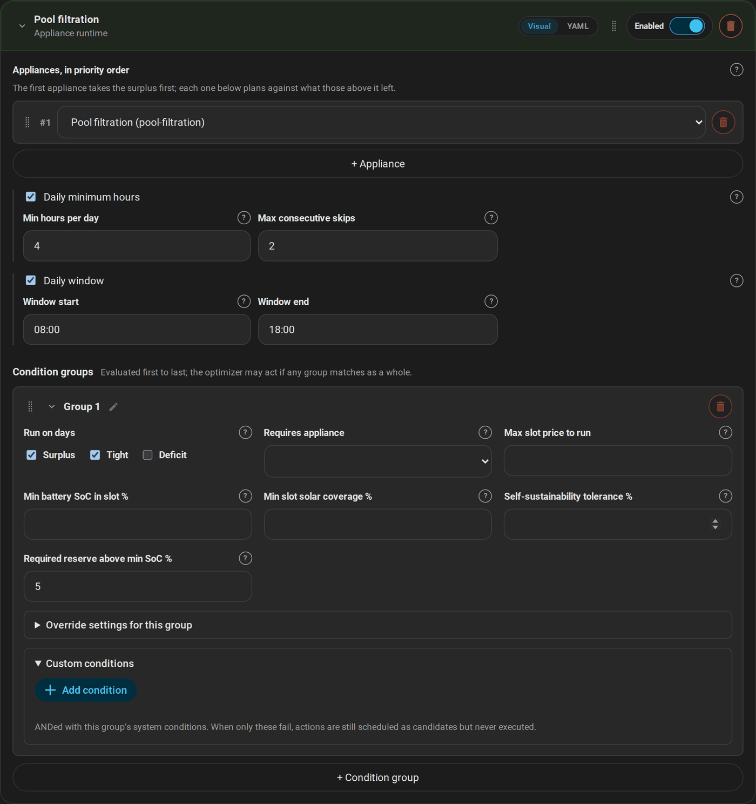

# Appliance runtime

**Goal:** run an appliance when it is cheapest and the sun pays for it, either for a guaranteed number of hours a day or whenever conditions allow.

{ .shot }

## Why

A pool pump on a 10:00–14:00 timer runs on cloudy days too and does not run on the bright evening after. A water heater on the cheap tariff ignores free noon sun. Appliance runtime places runs on the slots where running costs the least, based on the forecast for each day.

**What "costs the least" means.** Running on solar surplus means not selling that surplus, so a slot's cost is its **export price**: the income you give up. A slot whose surplus fully covers the appliance wins ties over one that needs the battery or the grid.

## Two modes

**With a daily minimum** (*Daily minimum hours* on): the appliance must run at least *N* hours a day within the window. Helman subtracts what it has already run today, from measured history, so manual runs count. It then places the rest on the cheapest eligible slots, preferring contiguous runs. A slot already running is kept, so the appliance does not stop mid-run when the ranking shifts.

**Without a daily minimum**: the appliance runs on **every** slot the conditions allow. Use it for "heat whenever there is surplus" kinds of loads. It needs at least a window or a condition, since "always on" is not a plan.

## Settings

| Setting | Meaning |
| --- | --- |
| **Appliances, in priority order** | One or more appliances sharing these settings. The first takes the surplus first, and each one below plans around those above. Each keeps its own daily minimum and history. A climate appliance also picks its mode (heat, cool…) |
| **Daily minimum hours** / **Max consecutive skips** | Hours per day to guarantee, and how many short days in a row are tolerated before a forced run |
| **Daily window** | Local start and end time. Without it, the whole horizon is allowed |

Conditions (per [condition group](condition-groups.md)):

| Condition | Use it to |
| --- | --- |
| **Run on days** | Run only on surplus (and tight) days |
| **Requires appliance** | Run only while another appliance is scheduled. The pool heat pump heats nothing while filtration is off |
| **Max slot price to run** | Run only when export is cheap. `0` = only at zero or negative prices |
| **Min battery SoC in slot** | Never run while the battery is projected below this |
| **Min slot solar coverage %** | Require the surplus to cover this share of the appliance's demand. 100 = only on pure surplus |
| **Self-sustainability tolerance %** / **Required reserve above min SoC %** | Limit what the appliance may take from the battery and the grid. See below |

## Daily minimum and skipped days

A day can fall short: it is a deficit day, prices stay high, or the battery floor refuses every slot. Each such day counts as a **skip**. Once *Max consecutive skips* is reached, the next day runs a **forced run**: the full minimum over the window, past every price and battery condition, on the slots that drain the battery least. A pool still gets filtered after three grey days.

A forced run does not override **Requires appliance**: being overdue does not make a heat pump heat while its circulation is off.

## Self-sustainability

Two numbers on each condition group control what running the appliance *does* to the battery, not just what the house looks like without it.

**Self-sustainability tolerance %**: how much of the battery's capacity the appliance may spend per day on energy the sun did not provide. Helman re-simulates the whole 48-hour horizon with the appliance's runs and without them, and adds up the difference:

```
spent = (how much lower the day ends in the battery) + (extra energy bought from the grid)
```

It must fit within the tolerance. On a 20 kWh battery, `10` allows 2 kWh a day. `0` means the day must pay for itself entirely from the sun. `100` switches it off. Empty ignores the battery.

**Required reserve above min SoC %** (default 5): a floor the projected battery must never cross at any point in the next 48 hours, in points above the inverter's minimum SoC. With a 10 % minimum and 5, the battery may never be projected below 15 %, so an evening run can be refused for a dip it would cause the next morning.

The two work at opposite ends: the tolerance limits *how much* is spent per day and bites when the battery is full; the reserve limits the *lowest moment* and bites when it is low. A refused slot is skipped and the next candidate tried, so a constrained day runs fewer hours rather than none.

## Good to know

- **Two optimizers, one appliance.** An air conditioner can have a *heat* optimizer and a *cool* optimizer, each with a temperature custom condition. Only the one whose conditions match acts.
- **Dependencies.** An optimizer using *Requires appliance* belongs below the optimizer of the appliance it depends on, so it sees that plan.
- **Energy per hour.** Placement needs the appliance's hourly energy, fixed or learned. See [Appliances](../devices/appliances.md#how-much-it-draws).
