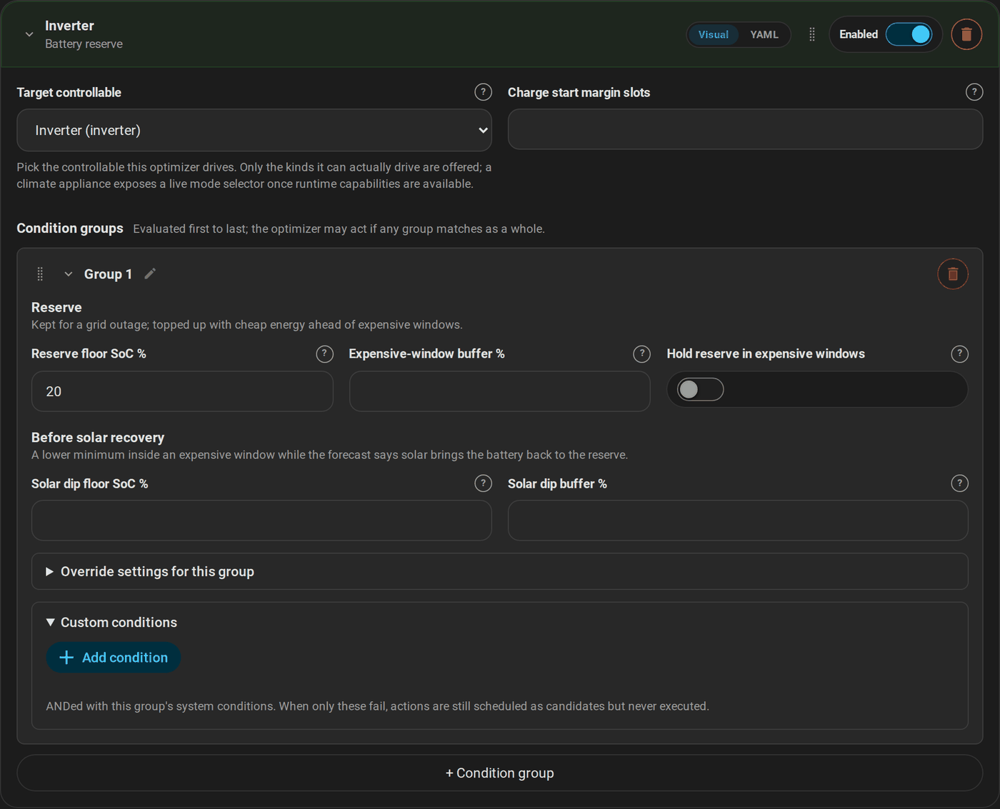

# Battery reserve

**Goal:** always keep a reserve in the battery for a grid outage, and bridge expensive import hours with energy bought in the cheap tariff before them.

{ .shot }

## Why

Two problems with one cause, a battery that empties at the wrong time:

- **Outage.** If the grid fails at 21:00 and the battery is at its 10 % minimum, the house is dark. You want, say, 20 % always held back.
- **Expensive hours.** With a two-rate tariff, every kWh imported in the expensive band costs more than the same kWh bought the night before. On a short winter day the battery runs out in the afternoon, and the evening runs on expensive grid power.

Battery reserve watches the projected battery through each expensive window. When it would drop below the reserve, it charges the missing energy from the grid in the **cheap band right before**, on the latest cheap slots, at the lowest target that suffices. An expensive window with no cheap band before it (for example after the day's last cheap window has passed) gets no bridge charge, only the reserve floor hold.

## How

The import price windows define the bands: the tariff's lowest price is *cheap*, everything above it is *expensive*. After the day's last cheap window has passed, the remaining expensive hours stay expensive. For each expensive window:

1. **Project.** Simulate the battery through the window, including the planned appliances.
2. **Measure the dip.** Find how far the lowest point falls below the required minimum: the reserve plus the expensive-window buffer.
3. **Charge just enough.** First hold the battery (no discharging) through the cheap band before the window, then charge the remaining gap in the latest cheap slots. Charging late means the energy sits in the battery for the shortest time.
4. **Keep the reserve in the cheap band too.** If the battery enters the cheap band below the reserve, its first slot charges back to the reserve and the band holds it there.

If the battery cannot be brought up enough (capacity or charge power), Helman aims for the best achievable and reports the limit.

## Settings

Reserve settings live in the condition group, so different groups can carry different reserves.

| Setting | Meaning |
| --- | --- |
| **Reserve floor SoC %** | The outage reserve. Held in cheap windows and planned for through expensive ones |
| **Expensive-window buffer %** | Headroom above the reserve when sizing the cheap charge, in case the forecast is too optimistic. The battery still discharges down to the reserve inside the window |
| **Hold reserve in expensive windows** | If the battery would still fall below the reserve inside an expensive window, stop discharging from that slot and import instead. Keeps the reserve, at the expensive price |
| **Solar dip floor SoC %** | A lower floor allowed inside an expensive window when the forecast says solar refills the battery to the reserve before the window ends. Avoids buying grid energy for a dip the sun will fix |
| **Solar dip buffer %** | Headroom above the solar dip floor, same idea as the expensive-window buffer |
| **Charge start margin slots** | Extra 15-minute charge opportunities included, without raising the target (default 2) |

!!! example "Reserve 20 %, buffer 10, dip floor 12 %"
    Before an evening expensive window the plan charges so that the forecast minimum is **30 %**. If the forecast is right, the battery still discharges to 20 % in the window, and the 10 points absorb a forecast miss. For a morning window that the sun will refill, the plan only makes sure the battery stays above **12 %**.

## Good to know

- **It only adds energy.** Battery reserve writes *Charging* and *No discharging*. It never stops the battery from charging.
- **Order against the EV hold.** With [Battery hold while EV charges](ev-battery-hold.md) above it in the list, a reserve charge replaces the hold where both act. Below it, the hold replaces the charge.
- **Detailed behaviour** with worked examples: [how a run plans, example 3](../automation.md#example-3-not-enough-sun).
