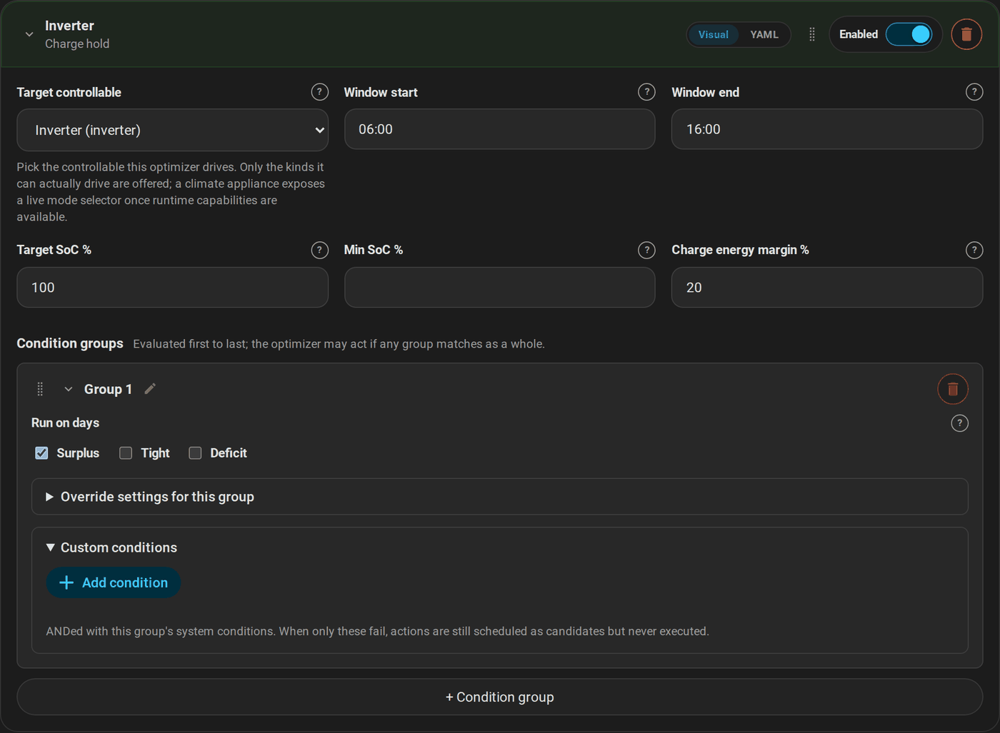

# Charge hold

**Goal:** fill the battery from the solar surplus that is worth the least, and sell the surplus that is worth the most.

{ .shot }

## Why

Left alone, the battery charges from the first sunbeam. On a sunny day it is full by 10:00, and the rest of the day's surplus is exported at whatever price noon brings. With spot export prices, the morning often pays more than midday, so charging first means selling the cheaper energy.

Charge hold turns this around. On days with enough sun, it keeps the battery from charging during the dearer export slots, so that surplus is sold, and lets it charge during the cheapest ones. The battery still ends up full; it just fills from the energy that was worth the least.

## How

For each day it runs:

1. **Size the need.** The energy needed to bring the battery from its forecast SoC at the window start to the **target SoC**, plus the **margin %** (20 % by default) in case the solar forecast is short.
2. **Rank the slots.** Every slot from the window start to the end of the day, by export price, cheapest first.
3. **Pick the charge set.** The cheapest slots whose forecast surplus together covers the need.
4. **Hold the rest.** Every slot *inside the window* that is not in the charge set gets **No charging**. Its surplus is exported.
5. **Then let go.** From the last charge-set slot on, nothing is held, so the battery can absorb a consumption peak and refill.

Slots after the window end are never held, but they count in the ranking. That way *hold all morning, charge in the afternoon* falls out naturally when the afternoon is cheapest.

## Settings

| Setting | Default | Meaning |
| --- | --- | --- |
| **Window start / end** | 06:00–14:00 | Where the optimizer may hold. Outside the window it never writes. |
| **Target SoC %** | 100 | What the battery must reach by the end of the charge set |
| **Charge energy margin %** | 20 | Extra surplus to reserve beyond the need. 20 = slots covering 120 % of it |
| **Min SoC %** | 0 (off) | Never hold while the forecast SoC entering a slot is below this. Such slots charge regardless of price |
| **Run on days** | Surplus | The [day types](../concepts/day-types.md) on which it runs |

## Good to know

- **Surplus days only, by default.** On a tight day there is no surplus to sell without risking an empty battery in the evening. Add *Tight* only with a margin and a min SoC you trust.
- **Negative prices flip it.** When export costs money, the cheapest slots are the negative ones, so charge hold charges there. Pair it with [Export price](export-price.md) to also stop exporting.
- **List order.** Put Export price below charge hold in the system list, so a *No export* slot wins over a hold.
- **A group per season.** Use [condition groups](condition-groups.md) with overridden windows, for example a later window on surplus days in summer.
