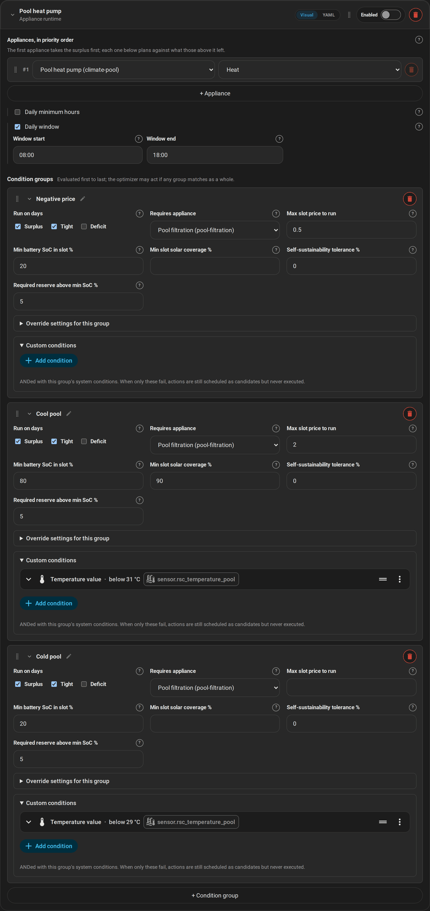

# Condition groups

Conditions say **when** an optimizer may act. They are organised in groups:

- **Within a group, every condition must hold** (AND).
- **Across groups, one matching group is enough** (OR). Groups are evaluated first to last.
- **A group can override parameters.** Under *Override settings for this group*, a group can set its own window, target SoC, price limit and so on. The first group that matches decides the parameters.

This is how one optimizer covers several situations. The pool heat pump below has three groups: run when the price is nearly free, run on solar when the pool is cool, and run on any surplus when the pool is cold.

{ .shot }

## System conditions

These are Helman's own conditions, evaluated per slot or per day against the forecast. Each optimizer kind offers the ones that make sense for it.

| Condition | Holds when | Used by |
| --- | --- | --- |
| **Run on days** (`run_when`) | The slot's day is one of the chosen [day types](../concepts/day-types.md) | Charge hold, Appliance runtime |
| **Requires appliance** (`requires_appliance`) | Another appliance is scheduled to run in the slot | Appliance runtime |
| **When price below** (`when_price_below`) | The export price is below the value | Export price |
| **Max slot price to run** (`max_run_price`) | The export price stays at or below the value for the whole slot | Appliance runtime |
| **Min battery SoC in slot** (`min_soc_pct`) | The projected battery SoC stays at or above the value for the whole slot | Appliance runtime |
| **Min slot solar coverage** (`min_solar_coverage_pct`) | Solar surplus covers at least this share of the appliance's demand | Appliance runtime |
| **Self-sustainability tolerance** (`ensure_self_sustainability`) | Running the appliance costs at most this share of battery capacity per day | Appliance runtime |
| **When solar below** (`when_solar_below_w`) | Solar power is below the value | Battery hold while EV charges |
| **Reserve floor SoC** and its qualifiers | — they set the reserve, see the page | Battery reserve |

Leaving a condition empty means *no restriction*. A value of `0` is a real limit: *Max slot price to run* `0` means *only at zero or negative prices*.

## Custom conditions

Any group can also hold **custom conditions**, ordinary Home Assistant conditions such as *the pool temperature is below 31 °C*, *the car is plugged in* or *nobody is home*. They are combined with the group's system conditions (AND), but they behave differently in time:

- **System conditions** are evaluated **when planning**, against forecasts. Their verdict is final for the run.
- **Custom conditions** are evaluated when planning **and again right before the slot executes**, against live state.

A slot whose system conditions hold but whose custom conditions fail is still planned, as a **candidate**: it appears in the plan, its demand is counted, but it is **not executed** until the custom condition holds. When a custom condition changes, Helman re-plans.

!!! example "Why candidates exist"
    *Charge the car from 11:00 to 14:00 when it is plugged in.* At planning time the car is away. The window is still planned as a candidate, so the battery plan knows the car might take that surplus. When you plug in at 11:30, Helman sees the condition change, re-plans within moments, and the window starts executing.

The [explanation view](../using/schedule-editor.md#explain-automation) shows custom conditions on the right of the dashed line, with the last evaluation trace one click away.
