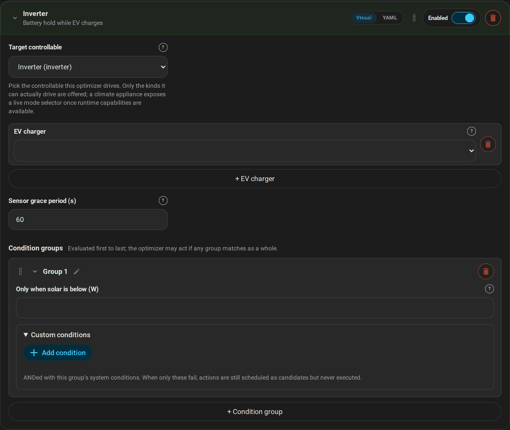

# Battery hold while EV charges

**Goal:** while the car charges, stop the house battery from discharging into it, so the car charges from the grid (or the sun) and the house battery stays for the house.

{ .shot }

## Why

An EV charger at 11 kW, plugged in at night, pulls from whatever is available. With the inverter in its normal mode, that includes the house battery: a 10 kWh battery is drained into a 64 kWh car battery in an hour. The car would have charged from the grid anyway, but now the house runs on the grid too, and the battery's charge was spent without any benefit.

## How

The optimizer writes **No discharging** to the inverter:

- **In future slots**, wherever a selected charger has a charging action in the schedule, whoever set it.
- **In the current slot**, wherever a selected charger is actually drawing power (above 1 kW), scheduled or not. A charge you started by hand holds the battery. A scheduled charge that is not drawing does not.

## Settings

| Setting | Default | Meaning |
| --- | --- | --- |
| **EV chargers** | — | The chargers (wallboxes, not cars) whose charging holds the battery. Each needs a power sensor |
| **Sensor grace seconds** | 60 | How long a charger still counts as charging after its power drops or its sensor goes unavailable. Rides through short dips without switching the inverter |
| **When solar below** (condition) | empty | Hold only in slots where solar is below this power. Empty holds whatever the sun does |

## Good to know

- **Daytime charging on sun.** With *When solar below* set, for example to 2000 W, a sunny midday charge does not hold the battery. Every crossing of the threshold switches the inverter, so passing clouds toggle the hold.
- **Order against the reserve.** In the system list, the lower optimizer wins a slot both want. Put this hold *above* [Battery reserve](battery-reserve.md) and a reserve charge replaces the hold. Put it *below* and the hold replaces the charge.
