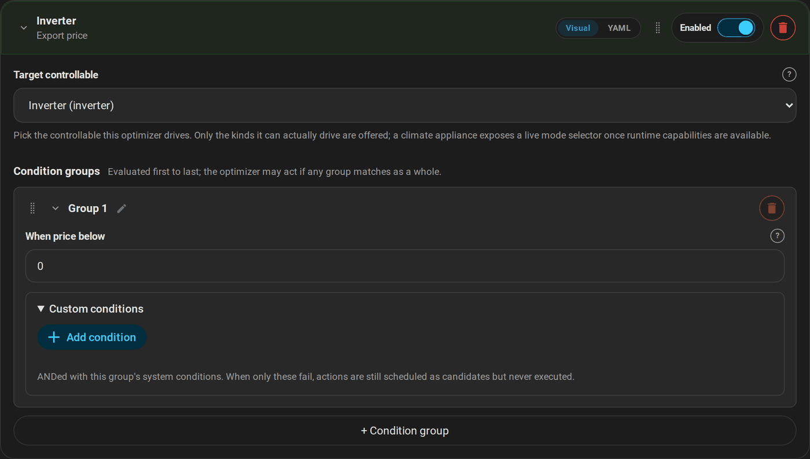

# Export price

**Goal:** do not export when the export price is too low, typically when it is negative.

{ .shot }

## Why

Spot export prices go negative on sunny, windy days: you pay to deliver power. Every kWh exported then costs money, and it is better to curtail the array or store the energy.

## How

In every slot where the export price is below **When price below** and the forecast expects export, the optimizer writes **No export**. The inverter then uses the surplus for the house and the battery and curtails the rest. That is the whole rule: there is no window, ranking or sizing.

With a hardware profile, *No export* sets the inverter's export limit to 0 and restores it to your contract's **max allowed export power** afterwards.

## Settings

| Setting | Meaning |
| --- | --- |
| **When price below** | Threshold in the export price's unit. `0` = only at negative prices |

## Good to know

- **Needs a *No export* mode.** Without one, the optimizer skips and says *the inverter cannot stop export*.
- **Combine with appliances.** Negative prices are the best time to run anything that can use the energy. An [appliance runtime](appliance-runtime.md) group with *Max slot price to run* `0` does exactly that.
- **List order.** Keep it below [Charge hold](charge-hold.md), so a protective *No export* wins a slot both want.
