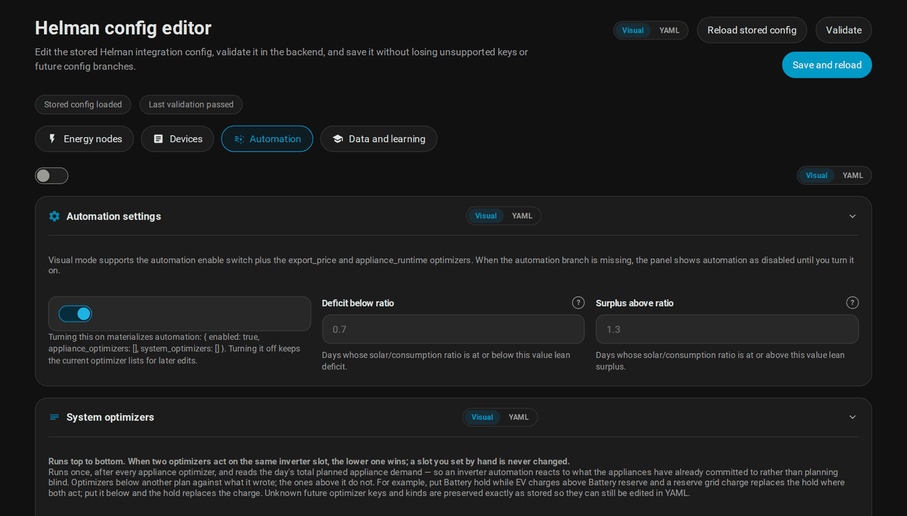

# Automation

Automation is the part of Helman that writes the [schedule](../concepts/schedule.md) for you. You describe **goals** as a list of optimizers, for example *keep 20 % for an outage* or *run the pool pump 4 hours a day on the cheapest slots*. Helman turns them into actions, slot by slot, every 15 minutes.

{ .shot }

## The philosophy

**Optimizers state goals, not timers.** You never write "charge from 01:00 to 04:00". You write "keep 20 % for an outage, and top it up from the cheap tariff before expensive hours". The hours follow from tomorrow's forecast, and they change when the forecast does.

**Every run starts from scratch.** Each run removes all automation-written actions and plans again from a bare house. Yesterday's decisions never leak into today's, and the same inputs always give the same plan.

**You stay in charge.** An optimizer only writes into slots no one has set by hand. Turning an optimizer off removes its actions on the next run.

**Every decision can be explained.** Each optimizer records why it placed or skipped every slot. Open the schedule editor's [Explain automation](../using/schedule-editor.md#explain-automation) view to read it.

## Two kinds of optimizers

| | System optimizers | Appliance optimizers |
| --- | --- | --- |
| **Control** | The inverter, and so the battery | One or more schedulable appliances |
| **Kinds** | [Charge hold](charge-hold.md), [Battery reserve](battery-reserve.md), [Export price](export-price.md), [Battery hold while EV charges](ev-battery-hold.md) | [Appliance runtime](appliance-runtime.md) |
| **Order means** | Lower in the list wins a slot both want | Higher in the list gets first pick of the surplus |

## How a run fits together

The battery's decisions depend on how much the appliances will consume, and the appliances' decisions depend on what the battery does. Helman resolves this in three phases:

1. **Appliances estimate** their demand, in list order, against a house with no battery actions.
2. **System optimizers plan** the inverter, in list order, against the house *including* that appliance demand.
3. **Appliances are placed for real**, in list order, now seeing the battery plan.

So the battery reserve knows the evening heater will run, and the heater knows the battery is held for an outage. The full mechanism, with worked examples, is in [how a run plans](../automation.md).

## Choosing optimizers

Start small. Each optimizer below solves one problem:

| Problem | Optimizer | Needs |
| --- | --- | --- |
| The battery fills at dawn, when exporting pays most | [Charge hold](charge-hold.md) | Export prices |
| An outage would find the battery empty; evenings import at peak price | [Battery reserve](battery-reserve.md) | Import price windows |
| Exporting at a negative price costs money | [Export price](export-price.md) | Export prices, a *No export* mode |
| A night EV charge drains the house battery into the car | [Battery hold while EV charges](ev-battery-hold.md) | An EV charger device |
| Appliances run on fixed timers regardless of sun and price | [Appliance runtime](appliance-runtime.md) | Schedulable devices |

Then look at [Recipes](recipes.md) for complete, tested combinations.

## Settings shared by all optimizers

Every optimizer has:

- an **Enabled** switch. A disabled optimizer keeps its settings and writes nothing;
- a **target**: the inverter, or the appliances it drives;
- its **parameters**, such as a window, a target SoC or a daily minimum;
- one or more **condition groups**: when it may act. → [Condition groups](condition-groups.md)

**Automation settings** at the top of the tab holds the master switch and the [day type](../concepts/day-types.md) thresholds.
