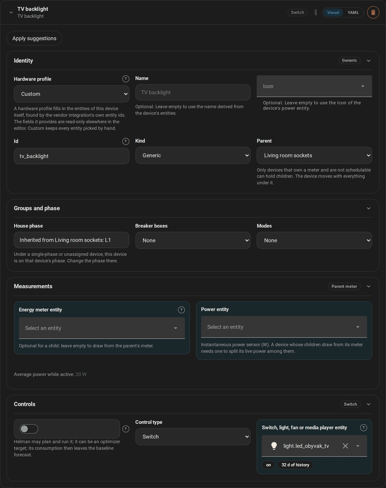
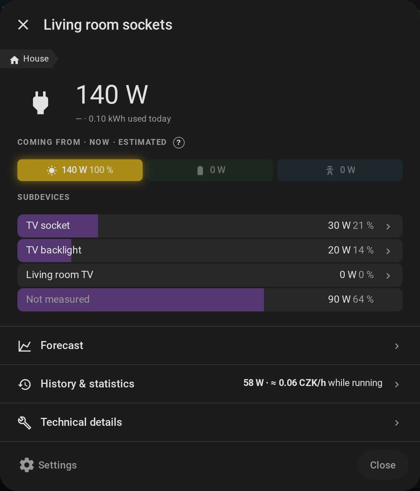
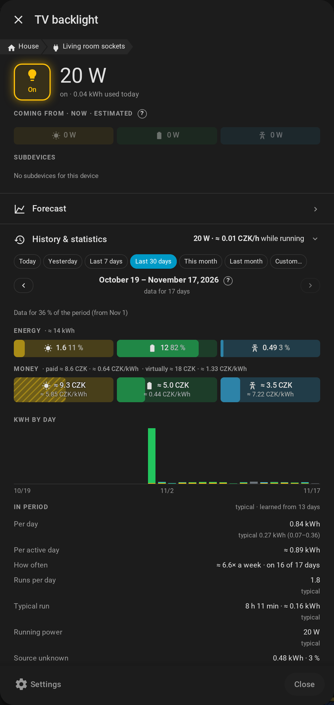

# The Helman device

In Home Assistant, a dishwasher is three unrelated entities: a smart plug's switch, its power sensor and its energy counter. A light on a breaker circuit is one entity, and the circuit's meter is another. Nothing tells Home Assistant that these belong together.

Helman does. It ties the pieces that describe one appliance into a **Helman device**, and every other part of Helman works with these devices rather than with loose entities.

## A device is a bundle

| Piece | Example | What Helman gets from it |
| --- | --- | --- |
| **Energy meter** (kWh, cumulative) | `sensor.dishwasher_energy` | What it used per hour and per day, for reports, training and the house forecast |
| **Power sensor** (W) | `sensor.dishwasher_power` | Live power, runs, power while running |
| **Control** | a switch, light, fan, media player, climate or cover entity | Whether it is on, and a way to switch it |
| **Kind** | generic, climate, EV charger | Which actions the schedule can give it |
| **Place in the tree** | under the *Kitchen sockets* breaker | Whose meter it draws from |
| **Groups and phase** | breaker box *Utility room*, phase L2 | Filing on the card, group actions, per-phase load |
| **Schedulable** | on / off | Whether Helman may plan and switch it |

You pick only the pieces you have. Bind the device to its **Home Assistant device**, and the meter, power and control pickers offer only that device's entities (or all, with *Show entities from all devices*). **Apply suggestions** proposes energy, power, switch and cover candidates, ranked by whether they belong to the same Home Assistant device.

{ .shot }

## One block, used everywhere

Once a device exists, every feature picks it up without further setup:

- the [flow card](../using/flow-card.md) shows it as a row with live power and history bars;
- it gets its own [node detail](../using/node-details.md) with power, schedule, forecast, usage and cost;
- the [device reports](../using/device-reports.md) rank it by energy and money and split its energy by source;
- nightly training learns its typical day, its runs and its power while running;
- [groupings](../devices/groupings.md) and the `helman.group_action` action switch it with the rest of its group;
- if it is **schedulable**, it leaves the house baseline, gets a lane in the [schedule](schedule.md) and can be driven by an [optimizer](../automation/index.md).

## Subdevices: following the wiring

Devices form a tree that follows your meters. A breaker circuit with a meter is a device. The sockets and appliances behind it are its **subdevices**:

```
Living room sockets   breaker meter + power   140 W
├── TV socket         plug with own meter      30 W  measured
├── TV backlight      light entity only       ≈20 W  learned
├── Living room TV    media player only        ≈0 W  learned, off
└── Not measured      the rest                 90 W
```

A parent's meter already includes its children, so Helman never adds children up into the parent. It subtracts them, and the remainder is the parent's **untracked consumption**. At the top of the tree, the house meter minus every device is the house's untracked consumption.

{ .shot .shot--narrow }

## Power for devices without a meter

This is where the bundle pays off. A subdevice with **only a switch**, like a light, a TV or an air conditioner on a shared breaker, has no power reading of its own. Helman still shows its power, its energy, its runs and what it cost.

**How.** Helman knows two things: the parent meter's power over time, and when each child was switched on. Every night it looks back over the parent's history and cuts it into stretches where the same set of children was on:

| Stretch | Children on | Parent drew | Tells Helman |
| --- | --- | --- | --- |
| night | none | 0.10 kW | standby of the circuit |
| evening | AC A | 1.50 kW | A ≈ 1.40 kW |
| morning | AC B | 0.80 kW | B ≈ 0.70 kW |
| afternoon | A and B | 2.40 kW | A + B ≈ 2.30 kW |

From all such stretches it fits each child's **typical power while on**: here A ≈ 1.44 kW, B ≈ 0.78 kW. Longer stretches count more, and a child that ran less than an hour in total gets the average of the others until it has more history.

**Live.** At any moment, the parent's own power (its reading minus children with their own meters) is shared among the children that are on, in the ratio of their learned power. Each child gets two entities:

- `sensor.helman_share_power_<id>`: its estimated power now;
- `sensor.helman_share_energy_<id>`: its cumulative energy, back-filled once from history, usable in the Energy dashboard.

Estimated figures are marked **≈** wherever they appear.

{ .shot .shot--narrow }

!!! tip "Getting the most out of it"
    - **One meter per circuit is enough.** A metered breaker plus the switches you already have gives a per-appliance breakdown without a plug meter on each device.
    - **The meter needs a power sensor** to share live power. The learned figures come from its energy history.
    - **Children with their own meter** are measured, not estimated, and are taken out of the parent before the split.
    - **Too many children always on together** cannot be told apart, and they get equal shares. A few days with different combinations improve the fit.

The full method, with worked examples for every learned figure: [learned device energy](../device-energy.md).

## Where to set it up

All of this lives in **Helman Energy Config → Devices**. [Devices](../devices/index.md) walks through building the tree, choosing passive or schedulable, and the appliance kinds.
