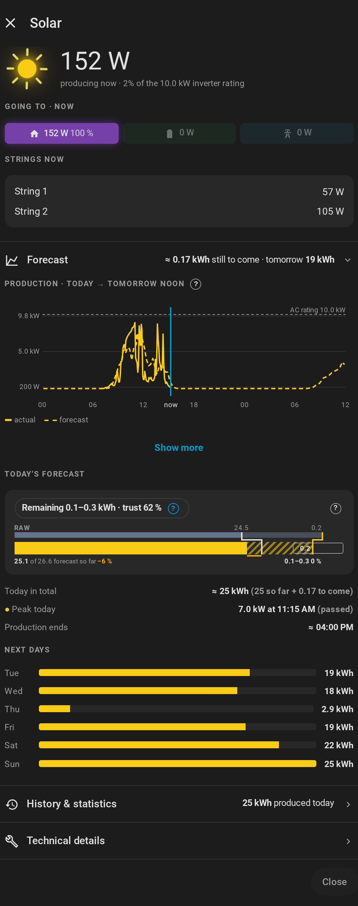
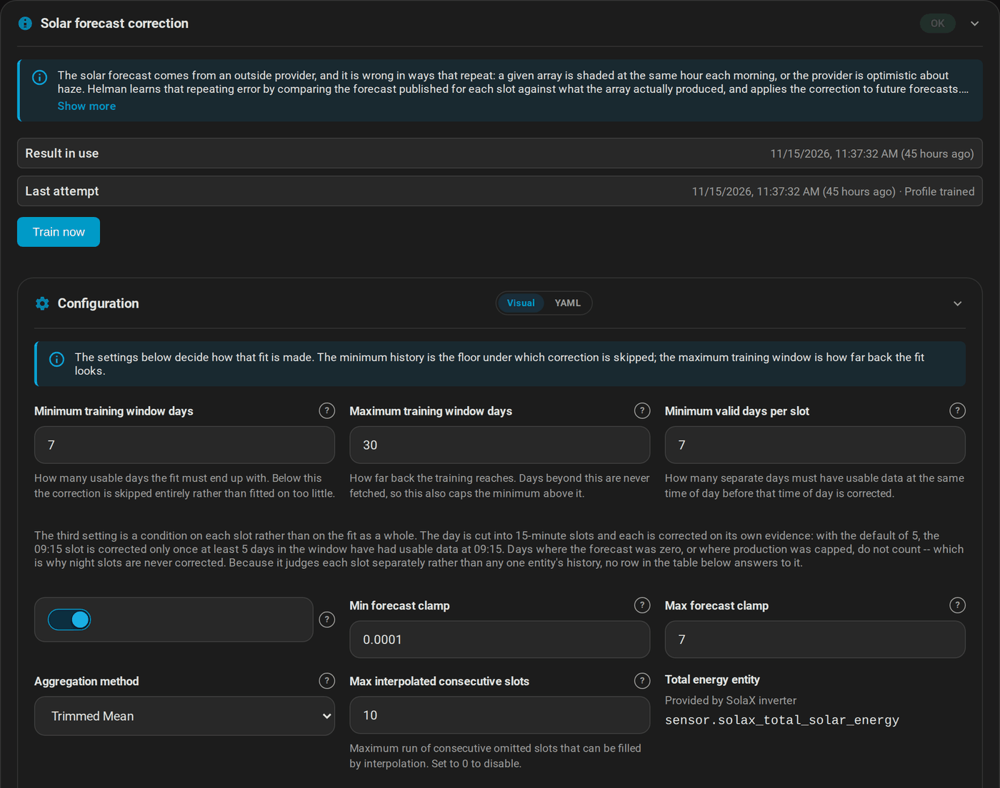
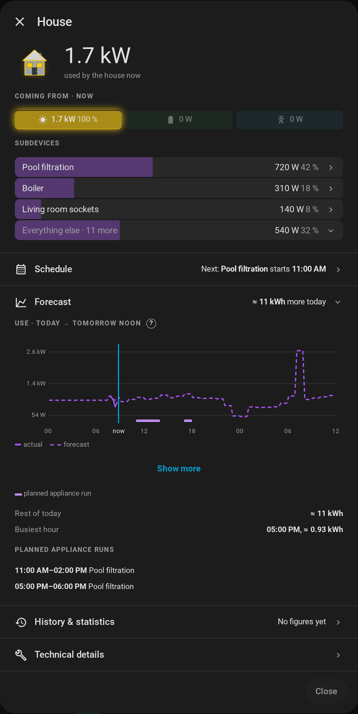
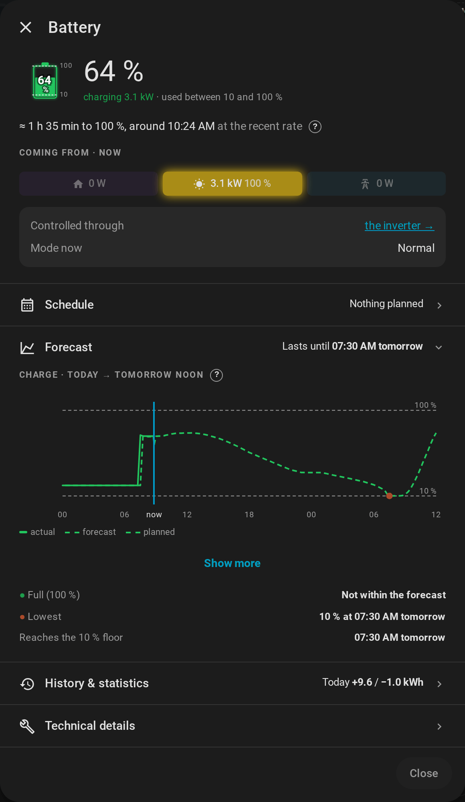

# Forecasts

A plan is only as good as what it plans against. Helman builds four forecasts for the next 48 hours, all in 15-minute slots, and rebuilds them every 15 minutes.

## Solar: your provider's forecast, corrected for your roof

Solar forecast services are wrong in ways that repeat. A tree shades the array at 8:30 every morning. A provider is optimistic in haze. A slightly misjudged azimuth makes the afternoon read high. Helman learns those errors and removes them.

**How.** Every night Helman compares, for each 15-minute time of day, the forecast published for that slot with what the array produced, over up to the last 90 days (at least 10 usable ones). The result is a correction factor per time of day (the 09:15 slot may be ×0.6, the 13:30 slot ×1.05), applied to every future forecast.

**What it ignores.** A slot is no evidence when the battery was full and nothing was exported: the inverter was throttling the array, so production reads low even though the forecast was right. Once you turn curtailment detection on, such *curtailed* slots are thrown out before training, together with meter glitches. Night slots and slots with too few usable days are not corrected at all.

**Today, live.** The nightly correction treats every day alike. The **live day ratio** adds today's own evidence: as the sun comes up, Helman compares today's production with the corrected forecast for the same slots and scales the rest of today by that ratio. A day running at half its forecast plans its afternoon at about half. The ratio is trusted more as the day goes on, fully once half of today's forecast energy should have arrived, and it stays between 0.3 and 2. The [solar day gauge](../using/node-details.md#solar-day-gauge) shows what it changed and how far to trust the rest of today.

{ .shot }
{ .shot }

Settings: [Data and learning → Solar forecast correction](../learning/index.md#solar-forecast-correction).

## House: what the household uses, hour by hour

Helman learns a profile of your house consumption for every hour of the week, from the cumulative house energy sensor, over the last 8 weeks by default. Monday 07:00 and Sunday 07:00 are learned separately.

The profile describes the **baseline**: the house total minus every schedulable appliance's own meter. Appliances are added back as **planned demand** where the schedule puts them, using either a fixed hourly energy or one learned from their history. So moving the pool pump in the schedule moves its consumption in the forecast.

{ .shot .shot--narrow }

## Battery: where the state of charge goes

The battery projection simulates the battery slot by slot from its live state of charge: forecast solar minus forecast demand, with each planned action applied, bounded by the battery's min and max SoC, maximum charge and discharge power and efficiencies. It is recomputed when a slot is edited, so the battery curve moves the moment you change the plan.

The projection answers the questions the optimizers ask: *will the battery be full by noon?*, *will it drop below 20 % before the cheap night tariff?*, *does running the heater at 18:00 empty it by midnight?*

{ .shot .shot--narrow }

## Grid and prices

From the solar, house and battery forecasts Helman derives the **grid import and export** per slot, and values them with:

- **Import price**: your tariff, entered as daily windows (for example 22:00–06:00 at 5.03, 06:00–22:00 at 7.33). Published as `sensor.helman_grid_import_price`.
- **Export price**: read from your price entity, including the day-ahead prices, and published as `sensor.helman_grid_export_price`.

These feed the money figures on the cards and every price-driven decision.

## When a forecast goes stale

Forecasts are rebuilt every 15 minutes. If rebuilding fails for over an hour, the cards show a warning banner and keep the last good forecast instead of going blank. The Home Assistant log says why.
