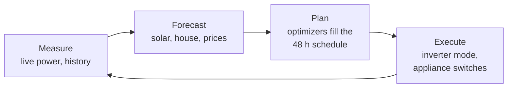

# Concepts

Helman has a lot of settings, but they all hang on a small number of ideas. Read this page once and the rest of the manual will make sense.

## The loop

1. **Measure.** Helman reads your power and energy sensors live, and keeps its own record of what each device used.
2. **Forecast.** It predicts solar production, house consumption and prices for the next 48 hours, and projects the battery state of charge through them. → [Forecasts](forecasts.md)
3. **Plan.** Optimizers write actions into a **schedule** of 15-minute slots: what the inverter does in each slot, and which appliance runs. → [The schedule](schedule.md), [Automation](../automation/index.md)
4. **Execute.** Every 30 seconds Helman makes the hardware match the current slot, if execution is on.

The loop re-plans at every slot boundary (`:00`, `:15`, `:30`, `:45`) and whenever you edit the schedule, so the plan always rests on the latest forecast.

## Five terms

**Slot.** 15 minutes. Every forecast, plan and action is aligned to slots.

**Horizon.** The 48 hours ahead of now. It slides with the clock, so "tomorrow" in a plan always means 24–48 hours from now.

**Lane.** One row of the schedule for one thing Helman controls: the inverter has a lane, and so does each schedulable appliance. A lane holds one action per slot.

**Baseline.** The house consumption you do not control: lights, cooking, the fridge. Helman learns it from history. Schedulable appliances are *not* in the baseline. They are planned on top of it, which is how the plan knows that moving the pool pump to noon frees the evening.

**Day type.** Each day is classified as **surplus**, **tight** or **deficit** by how its forecast solar compares with its forecast consumption. Many optimizers run only on certain day types. → [Day types](day-types.md)

## Who decides a slot

A slot can be set by **you** or by an **optimizer**. You always win:

- A slot you set by hand is never changed by an optimizer.
- An optimizer only writes into slots no one else owns. Each run, Helman removes every optimizer-written action and plans again from scratch, so a plan never drifts on stale decisions.
- When you clear your manual block, the slots go back to the optimizers on the next run.

## Plan versus execution

Planning and execution are separate on purpose:

- **Planning** always runs. The cards show what Helman would do.
- **Execution** (the **Execute actions** switch) decides whether the plan is applied to hardware. With it off, Helman changes nothing, and the forecast curves show the house as it will actually run: without the planned actions.

Just before applying a slot, Helman checks it against reality once more. If a [custom condition](../automation/condition-groups.md#custom-conditions) no longer holds, for example "only while the car is plugged in", the slot is not executed and Helman asks for a new plan.
