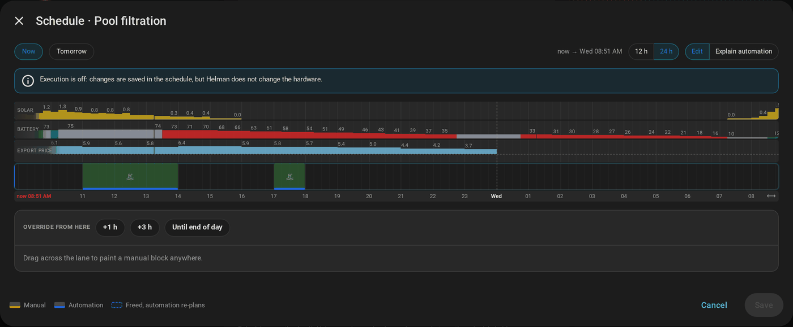
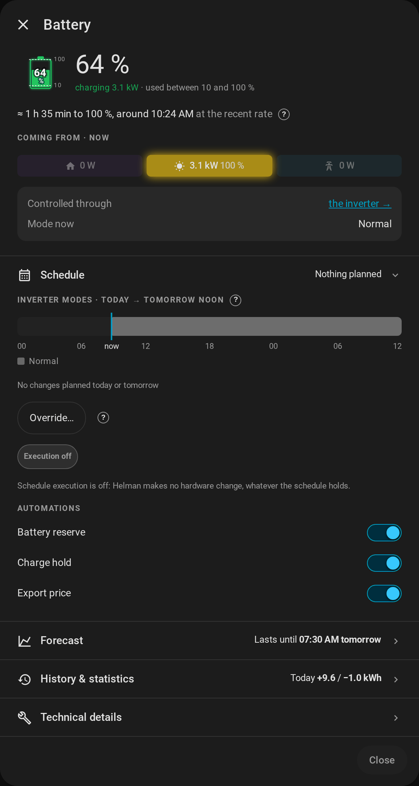
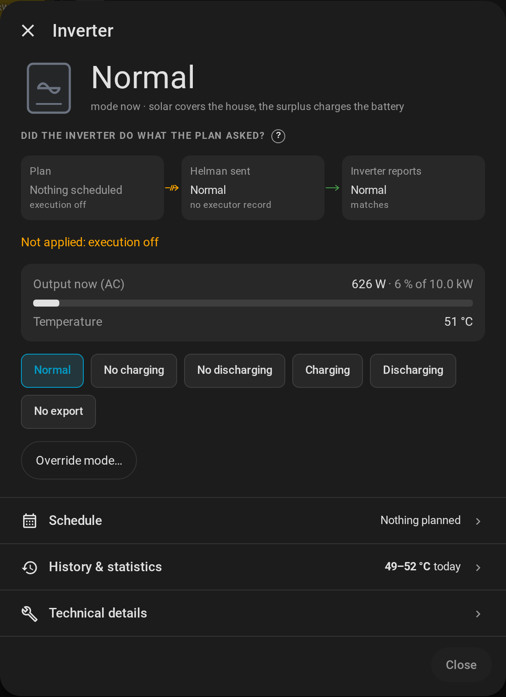

# The schedule

The schedule is Helman's plan: 48 hours of 15-minute slots, one lane for the inverter and one for each schedulable appliance. Optimizers fill it, you can override any part of it, and the executor applies the slot that covers *now*.

{ .shot }

## Inverter actions

The inverter lane holds one of these actions per slot. Each maps to an option of the inverter's mode select. A [hardware profile](../devices/hardware-profiles.md) maps them for you.

| Action | What the battery does | Typical author |
| --- | --- | --- |
| **Normal** | Self-use: solar feeds the house, surplus charges the battery, the battery covers the deficit | Default when nothing is planned |
| **Charging** to a target SoC | Charges up to the target, from the grid if solar is not enough | [Battery reserve](../automation/battery-reserve.md) |
| **Discharging** to a target SoC | Discharges down to the target | Manual |
| **No charging** | Does not charge; surplus is exported | [Charge hold](../automation/charge-hold.md) |
| **No discharging** | Does not discharge; deficits come from the grid | [Battery reserve](../automation/battery-reserve.md), [EV battery hold](../automation/ev-battery-hold.md) |
| **No export** | Exports nothing | [Export price](../automation/export-price.md) |

## Appliance actions

| Appliance kind | Actions |
| --- | --- |
| Generic (switch, light, fan…) | On / Off |
| Climate | On in a mode (heat, cool…) / Off |
| EV charger | Charge (vehicle, use mode, eco gear) / Don't charge |

A slot with no action leaves the appliance alone.

## Authorship

Each action remembers who set it: **you** (shown in amber) or **automation** (blue). The difference matters:

- Your actions are never removed or changed by an optimizer.
- Automation actions are recalculated on every run. Helman strips them all and plans again from a clean slate, so a plan made at 07:00 cannot linger at 15:00 after the forecast changed.
- When you free a slot you had set, it becomes available to the optimizers again (*freed, automation re-plans*).

## Execution

The **Execute actions** switch turns execution on and off for the whole schedule:

- **On**: every 30 seconds Helman finds the current slot and makes the inverter and every appliance match it. A command is sent only when the desired state differs from the last one applied.
- **Off**: nothing is sent. Planning continues and the cards show the plan.

Each node's **Schedule** section shows its plan, the execution state and the optimizers that drive it, each with its own on/off switch.

{ .shot .shot--narrow }

Before applying, Helman re-checks the slot's [custom conditions](../automation/condition-groups.md#custom-conditions) against live state. If one has stopped holding, the slot is not executed and a new plan is requested.

The inverter's node detail shows the chain for the current slot: what the plan asked, what Helman sent and what the inverter reports.

{ .shot .shot--narrow }
