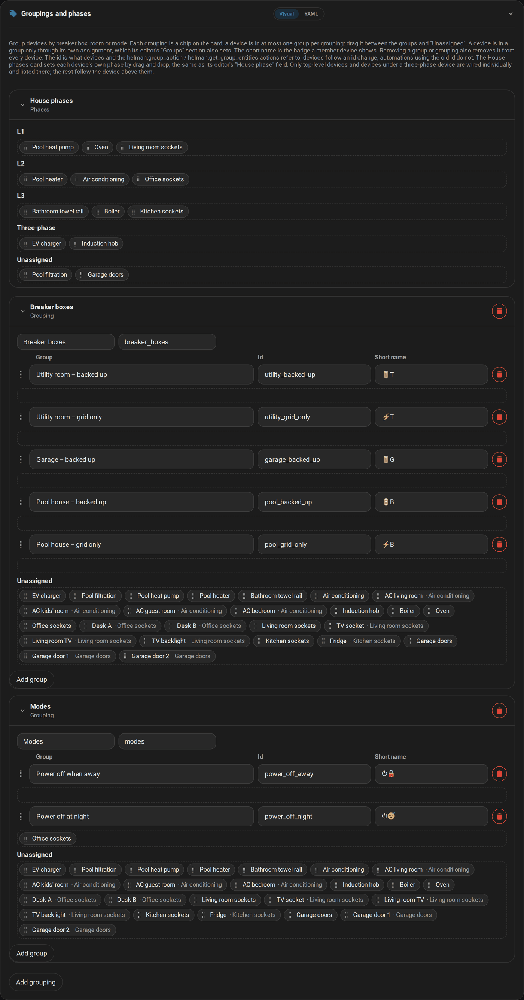

# Groupings and phases

## Groupings

A **grouping** is one way of sorting devices, for example by breaker box, by room, or by *what to turn off at night*. Each grouping has groups, and a device belongs to at most one group per grouping.

{ .shot }

- On the flow card, each grouping is a **Group by** chip, and the group's **short name** (an emoji or a few letters) is the badge its devices show.
- In the editor, drag device chips between groups and *Unassigned*, or pick the group in each device's **Groups** section.
- A child belongs to a group only through its own assignment. A child assigned to a different group than its parent moves to that group on the card, and its power is taken out of the parent so the totals still add up.

## Acting on a group from automations

Groups double as device lists for your own automations, so you keep them in one place instead of in HA labels.

```yaml
# Turn off everything in the "Power off at night" group
actions:
  - action: helman.group_action
    data:
      grouping: modes
      group: power_off_night
      action: turn_off       # turn_on | turn_off | toggle
      delay_ms: 500          # pause between entities (default 500)
```

```yaml
# Handle each entity yourself
sequence:
  - action: helman.get_group_entities
    data:
      grouping: modes
      group: power_off_away
    response_variable: group
  - repeat:
      for_each: "{{ group.entity_ids }}"
      sequence:
        - action: homeassistant.turn_off
          target:
            entity_id: "{{ repeat.item }}"
```

A group's entities are its members' on/off controls: the switch or light, else an EV charger's charge switch, else the climate entity. Members without any are returned in `skipped`. Use the grouping and group **ids** shown in the editor, not the names. Details: [Actions](../reference/actions.md).

## House phases

Assign each top-level device to **L1**, **L2**, **L3** or **Three-phase** under *House phases*. Children follow their parent unless the parent is three-phase. The house detail then estimates the load on each phase, next to the measured per-phase bars of the grid detail, so you see which phase is close to the main breaker.
