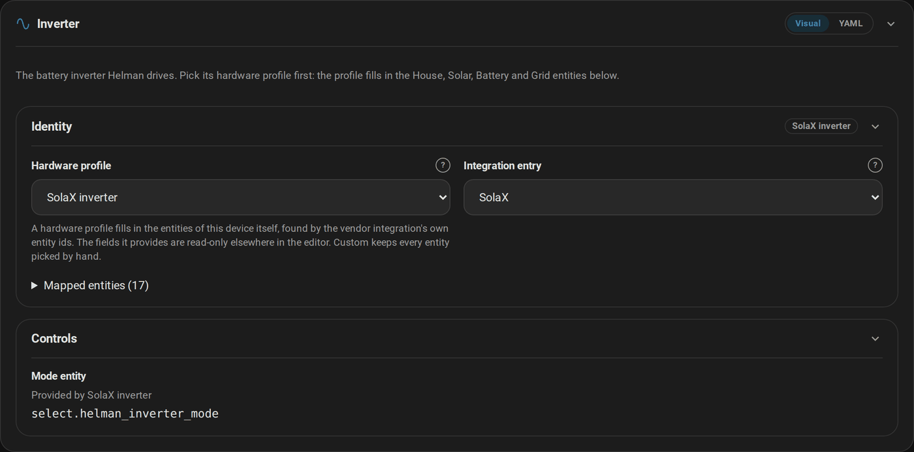

# Hardware profiles

A hardware profile describes one model of hardware. Picked on a device, it lets Helman find that device's entities by itself, in the entity registry of the vendor integration. You do not pick them one by one, and renaming an entity does not break anything. The fields a profile provides show up read-only in the editor, each with the entity it resolved to.

{ .shot }

Profiles cover the hardware. Facts about your site stay yours to set: maximum powers, prices, efficiencies, the solar forecast. A device without a profile (**Custom**) keeps every entity picked by hand.

## SolaX inverter

For SolaX hybrid inverters on the `solax_modbus` integration (built against the X3-Hybrid). Pick it in **Energy nodes → Inverter → Identity**, then the integration entry.

It provides:

- solar, battery, grid and house power and energy, with their sign conventions;
- the battery SoC bounds (the self-use discharge floor and the charge ceiling);
- the totals the house forecast and the solar correction train on;
- **control of the inverter**: Helman creates `select.helman_inverter_mode` with one option per [schedule action](../concepts/schedule.md#inverter-actions). Selecting an option, by the schedule or by you, writes the SolaX use mode (and the manual mode where needed), then the export limit: 0 for *No export*, otherwise your contract's **max allowed export power**, which the profile therefore requires.

## SolaX EV charger

For SolaX EV chargers on `solax_modbus`. Bound to the charger's HA device. Pick it first in the device's **Identity** section, or create the charger straight from **Add device**.

It provides the charger's energy and power meters, the use modes (*Fast* charges at full power, *ECO* follows the surplus), the eco gears (6 A at 3.5 kW, 10 A at 6.9 kW), and a charging switch `switch.helman_ev_charging_<device>` that starts and stops charging through the charger's control command. Vehicles stay yours to add.

## Other hardware

Profiles live in Helman's code, so supporting a new model is a code change. [Open an issue](https://github.com/Scarfsail/hass-helman/issues) with your integration's entities. Until then, **Custom** with [supporting entities](../supporting-entities.md) works with any inverter.
