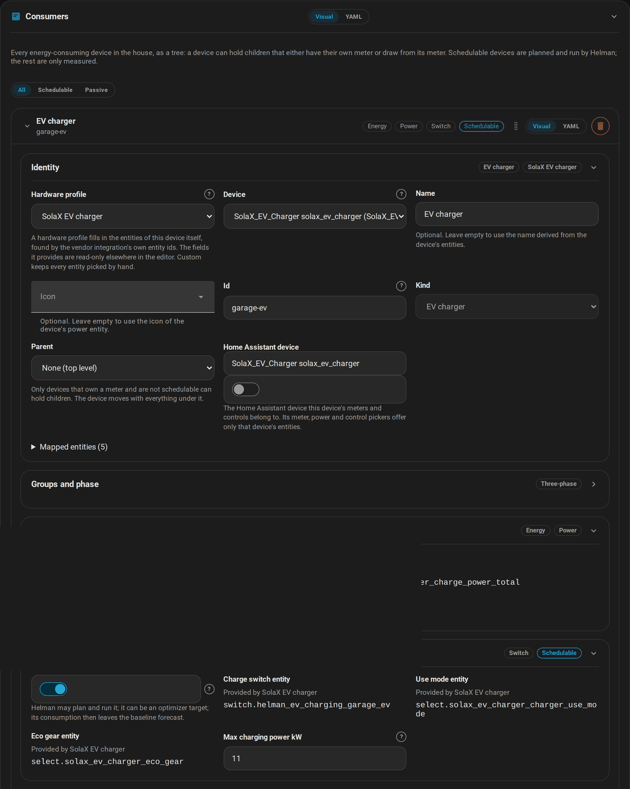

# Devices

The **Devices** tab describes everything in the house that uses electricity, as a tree. The tree drives the flow card, the reports, the house forecast and, for schedulable devices, the automation.

{ .shot }

## The tree follows your meters

Arrange devices the way your meters are wired:

```
House (house meter)
├── EV charger                 own meter, schedulable
├── Pool filtration            own meter, schedulable
├── Living room sockets        breaker meter, passive
│   ├── TV socket              own meter
│   └── TV backlight           no meter → estimated share
└── Air conditioning           breaker meter, passive
    ├── AC living room         no meter, schedulable (climate)
    └── AC bedroom             no meter, schedulable (climate)
```

- **A parent's reading includes its children.** Helman never sums children into the parent. Whatever the children do not explain becomes **👻 Untracked consumption** under it.
- **Only a passive device with a meter can hold children.** The children are the devices drawing from that meter.
- **Do not count twice.** Every meter in the tree must be a true sub-meter of the one above it and of the house total.

**Import from Energy dashboard** builds a first tree from the individual devices configured in Home Assistant's Energy dashboard.

## Passive or schedulable

| | Passive | Schedulable |
| --- | --- | --- |
| Helman | Measures it | Measures, plans and switches it |
| In the house forecast | Part of the learned **baseline** | Taken out of the baseline, added back as **planned demand** |
| Optimizer target | No | Yes |

Make a device schedulable only when Helman may really decide when it runs. Its energy then leaves the baseline, and the forecast expects it only where the plan puts it. A device with children cannot be schedulable; make the children schedulable instead.

## Device kinds

| Kind | Control | Example |
| --- | --- | --- |
| **Generic** | A switch, light, fan or media player | Pool pump, heater, boiler relay |
| **Climate** | A `climate` entity and a mode | Air conditioner, pool heat pump |
| **EV charger** | Charge switch, use mode, eco gear, vehicles | Wallbox → [EV charger](ev-charger.md) |

How Helman estimates what an appliance draws: [Appliances](appliances.md).

## Shared meters

Several devices often hang on one meter: four air conditioners on one breaker, three lamps on a smart plug. A child **without its own meter** gets an estimate: the parent's own power, split evenly among its children that are running. Helman publishes it as `sensor.helman_share_power_<id>`, with a cumulative `sensor.helman_share_energy_<id>` whose history is back-filled once. Estimated values are marked ≈ everywhere.

## Every device's own detail

Each device gets a [node detail](../using/node-details.md) with its power, schedule, forecast, usage and money. Every night Helman learns each device's typical day, its runs and its power while running. See [Data and learning](../learning/index.md#device-energy).
