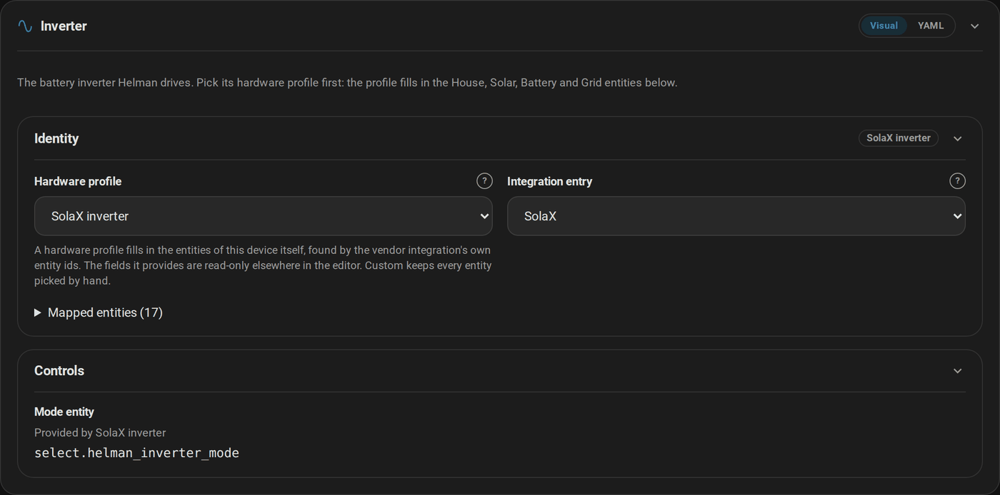
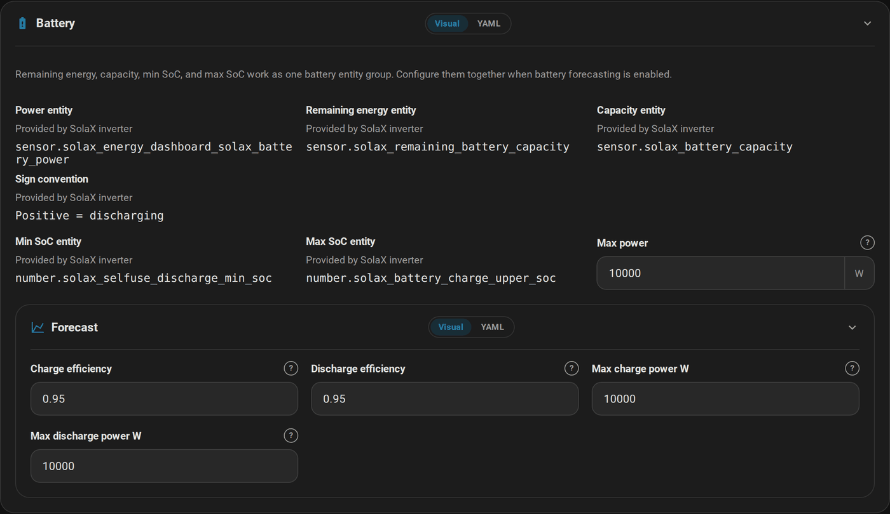
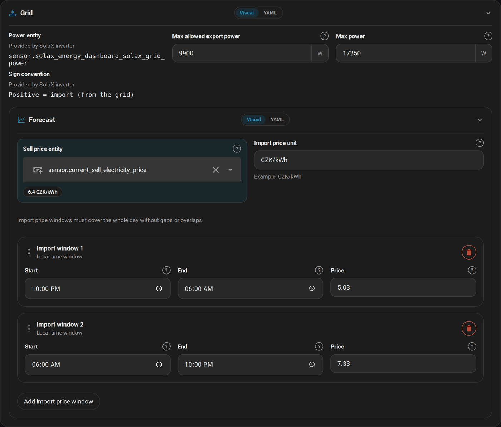
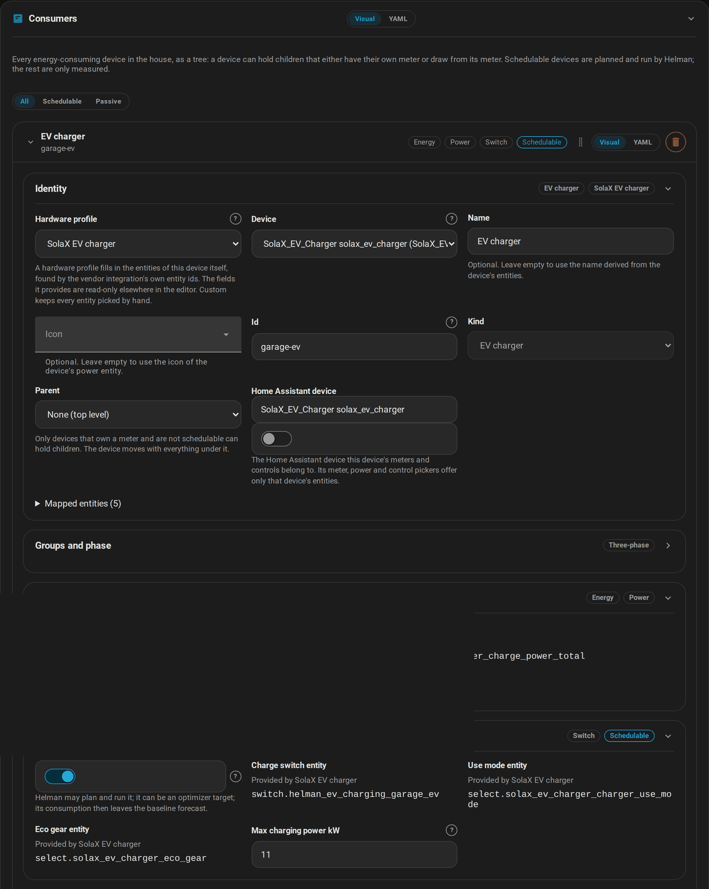
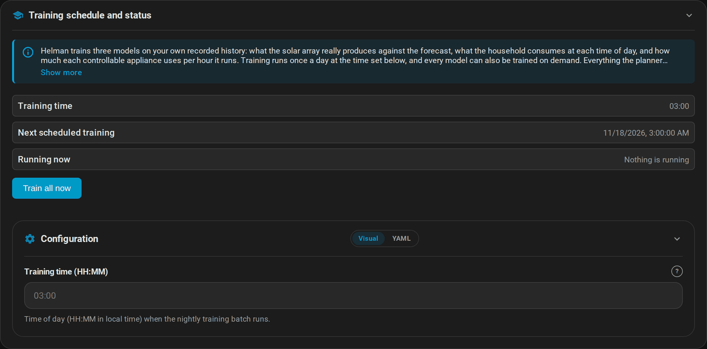

# First setup

All configuration happens in the **Helman Energy Config** panel in the sidebar. It has four tabs, and this page walks through them in the order that works best. Every section can be edited visually or as YAML. **Validate** checks the draft against the backend, and **Save and reload** stores it and restarts Helman with it.

!!! tip "Nothing touches your hardware yet"
    Planning starts as soon as the config is saved, but Helman changes hardware only while **Execute actions** is on, and it starts off. You can set up everything, watch the plans for a few days and switch execution on when you trust them.

## 1. Energy nodes: the inverter first

{ .shot }

Open **Energy nodes → Inverter** and pick a **hardware profile** if one fits your inverter. A profile finds every entity of the inverter through its vendor integration: solar, battery, grid and house power and energy, the SoC bounds and the mode control. Those fields then show up read-only in the sections below. See [Hardware profiles](../devices/hardware-profiles.md).

Without a profile (**Custom**), set the **mode entity**: an `input_select` or `select` that Helman writes to. Then map each schedule action to one of its options:

| Action | Meaning |
| --- | --- |
| **Normal** | The inverter's own self-use behaviour |
| **Charging** | Charge the battery to a target SoC, from the grid if needed |
| **Discharging** | Discharge to a target SoC |
| **No charging** | The battery does not charge; surplus goes to the grid |
| **No discharging** | The battery does not discharge; the house runs on solar and grid |
| **No export** | Nothing is exported; surplus is curtailed or stored |

Leave an action empty if your inverter cannot do it. The optimizers that need it then skip their work and tell you why. [Supporting entities](../supporting-entities.md#4-battery-scheduling-control) shows how to build such a selector.

## 2. Energy nodes: solar, battery, grid, house

Each node needs its power sensor. Set the **sign convention** to match the sensor instead of building a template to flip it. For example, a grid sensor that reads positive while importing is *Positive = import*.

{ .shot }
{ .shot }

- **Solar**: the power and today's energy sensors, the array's **max power**, and the **daily energy entities** of your solar forecast: entity 1 is today, entity 2 tomorrow, and so on up to 8 days. Helman reads their hourly or 15-minute breakdown (`wh_period`, `wh_period_15m` or `watts` attributes).
- **Battery**: SoC, remaining energy, min and max SoC, the charge and discharge efficiencies and the maximum charge and discharge power. The battery planning is only as good as these numbers.
- **Grid**: the signed power sensor, today's import and export, the **max allowed export power** from your grid contract, the **sell price entity** and your **import price windows**. The windows must cover the whole day without gaps, and every price must be a finite number. The tariff's lowest price is the *cheap* band and every window priced above it is *expensive*. After the day's last cheap window has passed, the remaining expensive hours stay expensive. The [battery reserve](../automation/battery-reserve.md) is planned around these bands.
- **House**: the power sensor and, under **Forecast**, a **cumulative house energy** sensor. The consumption forecast trains on it.

!!! info "Export price entity format"
    Helman reads the current price from the entity's state and the day-ahead prices from attributes keyed by timestamp (`"2026-11-17T08:00:00+01:00": 6.39`). It republishes both as `sensor.helman_grid_export_price`; everything else reads that sensor.

## 3. Devices

{ .shot }

The **Devices** tab is the tree of everything in the house that uses energy. Start with **Import from Energy dashboard** if you already configured individual devices there, then:

- Mark a device **schedulable** when Helman may plan and switch it (a pool pump, a heater, an EV charger). Its consumption then leaves the house *baseline* forecast and becomes planned demand.
- Leave the rest **passive**. Helman measures them and nothing more.
- Put sub-meters under the meter they hang on (sockets under a breaker), so nothing is counted twice.

[Devices](../devices/index.md) explains the tree, appliance kinds and the EV charger.

## 4. Data and learning

{ .shot }

Defaults are fine to start. Training runs every night at 03:00 and needs history: the house profile wants 14 days, the solar correction 10 usable days. Until then the forecasts run uncorrected and the tab says what is missing. [Data and learning](../learning/index.md) explains each model.

## 5. Watch the plan

Add the [inspector card](../using/inspector.md) to a dashboard and look at today and tomorrow. You should see the solar forecast, the house forecast, the projected battery SoC and, once optimizers exist, the planned actions. Click a planned slot and use **Explain automation** to check the reasoning.

## 6. Turn on automation, then execution

1. In **Automation**, switch automation on and add the optimizers you want. Start with one, for example [Export price](../automation/export-price.md) or [Charge hold](../automation/charge-hold.md). The [Automation](../automation/index.md) chapter helps you choose.
2. Save, and watch the plan for a day or two.
3. When it looks right, turn on **Execute actions**. The switch is in the inspector card, next to the scheduled actions, and in every node's schedule section. From then on Helman checks every 30 seconds that the inverter and appliances match the current slot.

You can turn execution off at any time. Planning goes on, and the cards keep showing what Helman *would* do.
