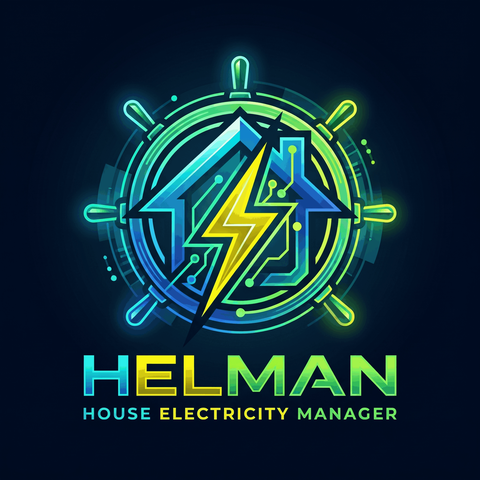
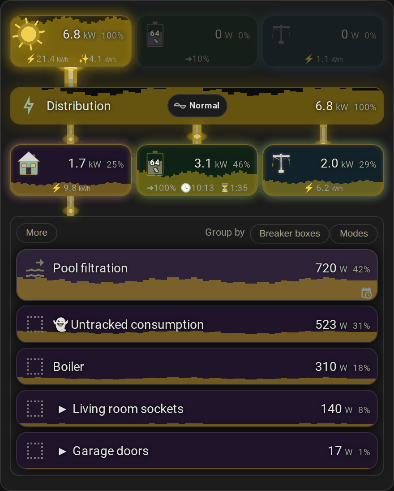
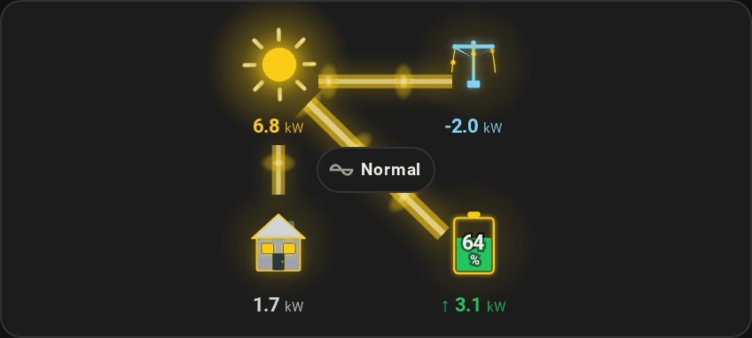
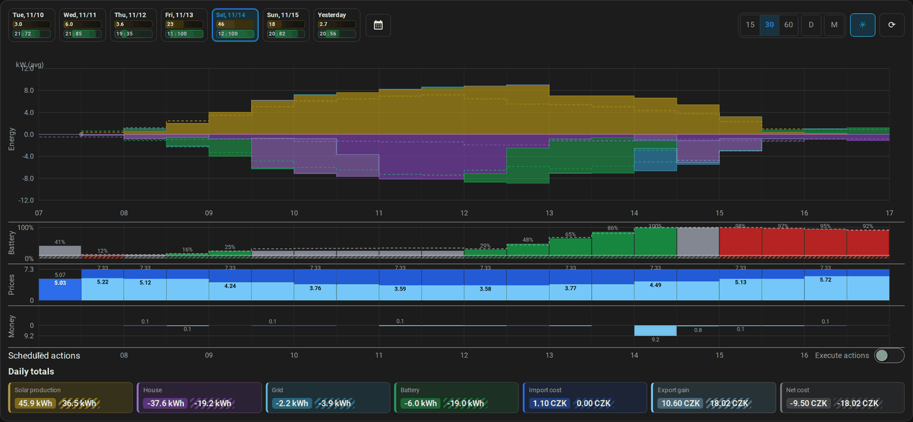
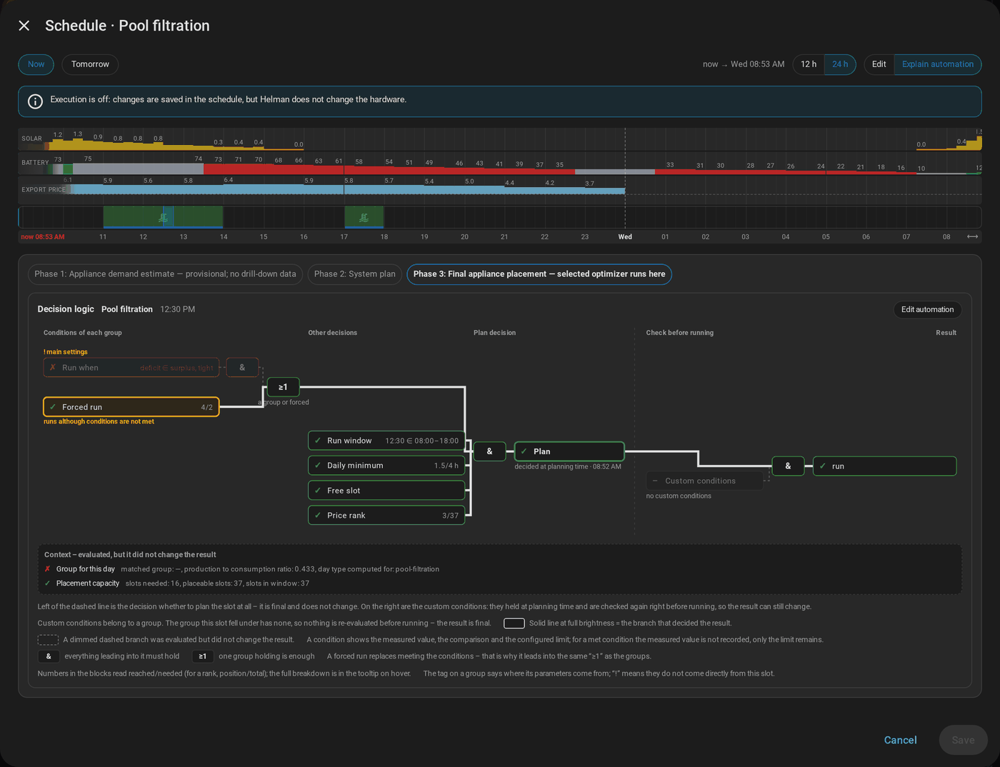

---
hide:
  - navigation
---

# Helman { .hero-title }

**Helman runs the electricity of a house with solar panels and a battery.** It learns what your roof produces and what your house consumes, plans the next 48 hours in 15-minute slots, and drives the inverter and your appliances by that plan. Everything runs inside Home Assistant.

## Why Helman

A home battery left on its default setting charges as soon as the sun comes up and empties as soon as the sun goes down. That is rarely the best use of it:

- With spot prices, morning export often pays more than noon export. A battery that fills first thing stores the well-paid morning energy and leaves the cheap noon surplus for export.
- In the evening, the grid is expensive. A battery that ran empty at 19:00 makes you buy the most expensive hours of the day.
- When the grid goes down, an empty battery protects nothing.
- Your pool pump, boiler or air conditioning run on a timer you set once, whether today is sunny or not.

Helman replaces those fixed rules with a plan. It knows tomorrow's solar forecast, corrected for your own roof. It knows your household's consumption by hour of the week, the import tariff and the day-ahead export prices. From those it decides, slot by slot, when the battery charges, holds or stops exporting, and when each appliance runs.

## What you get

-   :material-transit-connection-variant: **See where every watt goes**

    ---

    One live card for solar, battery, grid and house, with the house split into a tree of devices, breakers and sockets. Consumption that no meter explains shows up as its own row.

    [:octicons-arrow-right-24: Energy flow card](using/flow-card.md)

-   :material-crystal-ball: **Forecasts you can trust**

    ---

    Your solar forecast, corrected for the repeating errors of your own roof, and scaled live through the day. A learned house consumption profile. A battery state-of-charge projection that follows every planned action.

    [:octicons-arrow-right-24: Forecasts](concepts/forecasts.md)

-   :material-calendar-clock: **A 48-hour plan that acts**

    ---

    Optimizers write the plan: charge the battery in the cheapest export slots, keep an outage reserve, stop exporting at negative prices, run appliances on surplus. Helman then executes it through your inverter and switches.

    [:octicons-arrow-right-24: Automation](automation/index.md)

-   :material-head-question: **Every decision explained**

    ---

    Click any planned slot to see why it is there: which conditions held, which did not, and what was checked again right before running.

    [:octicons-arrow-right-24: Editing the schedule](using/schedule-editor.md)

## A quick look

{ .shot }
{ .shot }

The **energy flow card** shows live power from solar, battery and grid, how it is split, and every device in the house as a tree. The **simple card** shows the same flows in a compact diagram for a wall tablet.

{ .shot }

The **inspector** puts a day on one chart: the solar forecast against what the roof produced, house consumption, battery and grid flows, the battery charge, import and export prices, and the money made or spent per slot. Past days show what happened. Today and the days ahead show the plan.

{ .shot }

The **schedule editor** lets you override any slot by hand. Its *Explain automation* view shows the decision logic of the optimizer that planned the slot.

## Typical use cases

| You want to… | Helman does it with |
| --- | --- |
| Sell midday surplus at the best price and fill the battery from the cheapest slots | [Charge hold](automation/charge-hold.md) |
| Always keep, say, 20 % in the battery for a grid outage, topped up with cheap night energy | [Battery reserve](automation/battery-reserve.md) |
| Stop exporting when the export price goes negative | [Export price](automation/export-price.md) |
| Charge the car at night from the grid without draining the house battery into it | [Battery hold while EV charges](automation/ev-battery-hold.md) |
| Run the pool filtration 4 hours a day, in the sunniest and cheapest hours | [Appliance runtime](automation/appliance-runtime.md) |
| Heat the pool only when filtration runs and the sun pays for it | [Appliance runtime, condition groups](automation/condition-groups.md) |
| Heat with air conditioning only on days with surplus, and never below 30 % battery | [Appliance runtime, self-sustainability](automation/appliance-runtime.md#self-sustainability) |
| Know which device costs you the most, and whether it ran on sun or grid | [Device reports](using/device-reports.md) |
| Turn off a group of sockets for the night from one automation | [Groupings and actions](devices/groupings.md) |

## What you need

- Home Assistant with the **Recorder** keeping your history.
- A **hybrid inverter with a battery** whose integration exposes power, energy and state-of-charge sensors, and a way to switch its mode. [SolaX](devices/hardware-profiles.md) is supported out of the box; any other inverter works through [hand-made helpers](supporting-entities.md).
- A **solar forecast** integration that publishes per-day energy with an hourly or 15-minute breakdown (Forecast.Solar and compatible ones).
- Optionally an **export price** entity with the day-ahead prices and your **import tariff** windows. Without prices, the price-driven optimizers have nothing to rank on.

Ready? Start with [Getting started](getting-started/index.md).
