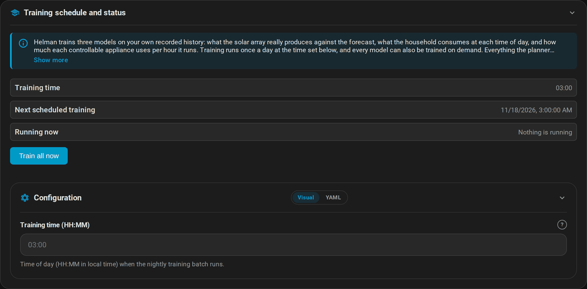
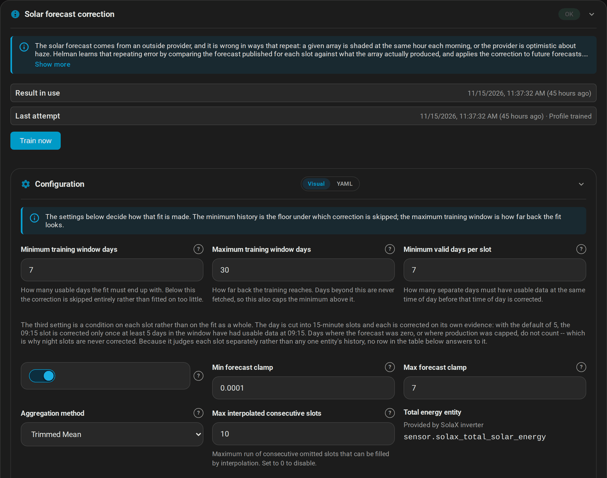
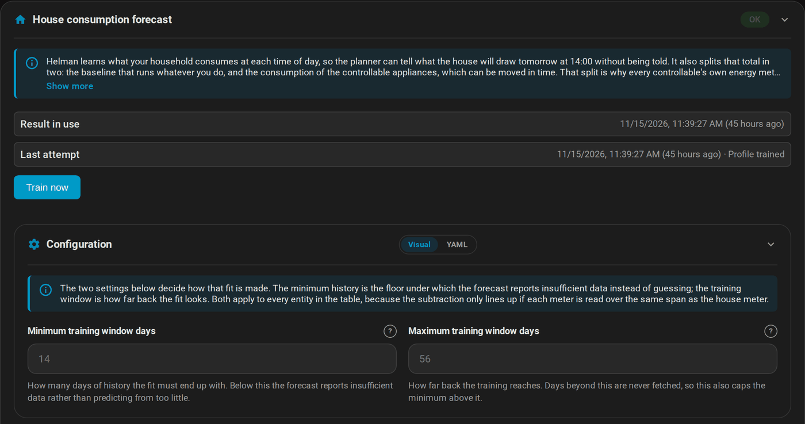

# Data and learning

Helman trains three models on your own recorded history. Everything it predicts rests on them, so the **Data and learning** tab shows each model's status, what it was trained on and why it might be degraded.

{ .shot }

Training runs **once a night** at the training time (03:00 by default), because it reads a lot of Recorder history. Each model can also be trained on demand with **Train now**. Changing a model's settings retrains it right away. The results are stored, so a restart does not recompute them.

## Solar forecast correction

Learns how your forecast provider is wrong for your array, per 15-minute time of day. Why and how: [Forecasts → Solar](../concepts/forecasts.md#solar-your-providers-forecast-corrected-for-your-roof).

{ .shot }

| Setting | Default | Meaning |
| --- | --- | --- |
| Minimum / maximum training window days | 10 / 90 | Fewer usable days than the minimum: no correction. Older than the maximum: ignored |
| Minimum valid days per slot | 5 | A time of day is corrected only with this many usable days for it |
| Min / max forecast clamp | 0 / 3 | Bounds for a correction factor |
| Max interpolated consecutive slots | 2 | Short gaps between corrected slots are interpolated |
| **Live day ratio** | on | Scales the rest of today by how today is going. Fully trusted after half of the day's forecast; bounded 0.3–2 |
| **Invalidate training slot data** | curtailment off | Setting *Max battery SoC %* turns curtailment detection on: a slot with the battery at or above it, export within the 50 W deadband and production below 0.8 × forecast is excluded. Meter glitches (spikes, false zeros) are excluded too |

The diagnostics show the factors, how many slots were omitted or invalidated, and a day chart of raw against corrected forecast.

## House consumption forecast

Learns what the household consumes in each hour of the week. It learns the **baseline**: the house total minus every schedulable appliance's own meter.

{ .shot }

| Setting | Default | Meaning |
| --- | --- | --- |
| Minimum training window days | 14 | Less history than this: no forecast |
| Maximum training window days | 56 | How far back the fit reads. The largest driver of the nightly training cost |

The diagnostics list every meter the model reads, with how much detailed and long-term history it has.

## Device energy

Learns how every device uses energy: its typical day, its runs (how many, how long, how much) and its average power while running. These figures fill the device details. An appliance on the **history average** strategy also learns its energy per hour while on, which its forecast then uses. How each figure is calculated: [learned device energy](../device-energy.md).

## Recent power history

Not a model: Helman's live sampler, which draws the bars on the flow card and averages the battery time-to-full and time-to-empty. By default it takes a reading every 5 seconds and keeps the last 60, so 5 minutes.
