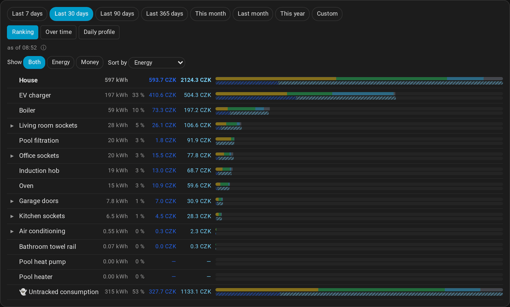
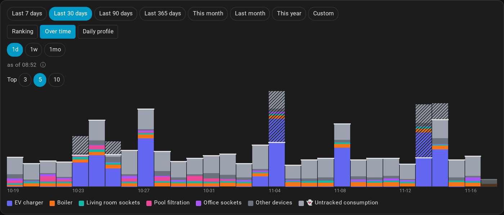
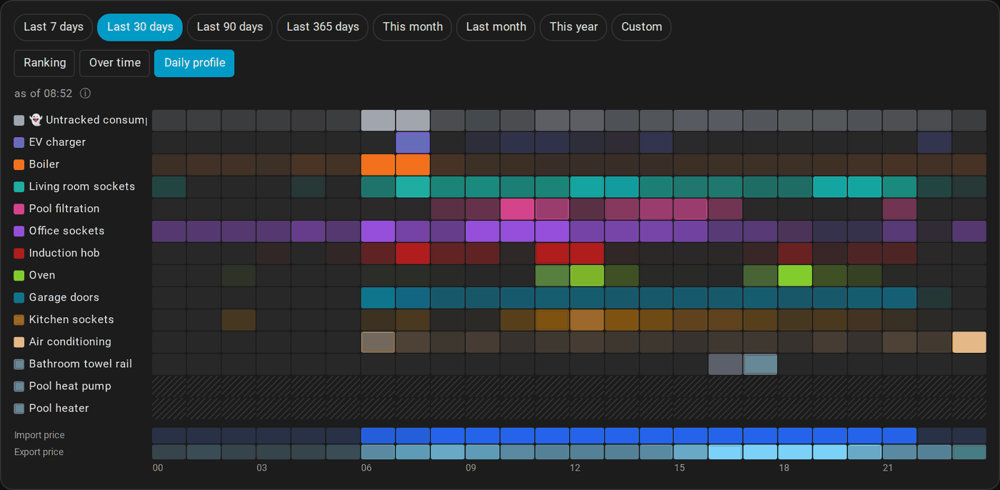

# Device reports

`custom:helman-device-reports-card` answers: *which devices use the energy, where does it come from, and what does it cost?* It needs nothing beyond what Helman already records.

{ .shot }

## Three reports

- **Ranking**: every device over the period, sorted by energy or money, as a tree like the flow card. Each bar shows the source split: solar, battery, grid.
- **Over time**: the top devices per day, week or month, stacked.
- **Daily profile**: when in the day each device runs, against the price.

{ .shot }

{ .shot }

Pick the period above the reports: the last 7, 30, 90 or 365 days, this month, last month, this year or a custom range of up to 366 days.

## Paid and forgone

Each device has two money figures:

- **Paid**: what its energy cost. Grid energy at the import price of that hour, and battery energy at what charging it cost.
- **Forgone**: what its energy could have earned. Solar energy at that hour's export price, since you could have sold it instead.

A device that ran on solar at noon has *paid* nothing but *forgone* the export income. That is the honest price of running it then. Forgone can be negative when the export price was. When a figure could not be priced fully, it is drawn hatched and marked *partial*.

## Where the numbers come from

Hourly long-term statistics of every device meter, of the house meter, and of the solar, battery and grid meters. Devices without their own meter use their estimated share sensor (marked ≈). The full method is in [the device reports deep dive](../device-reports.md).
