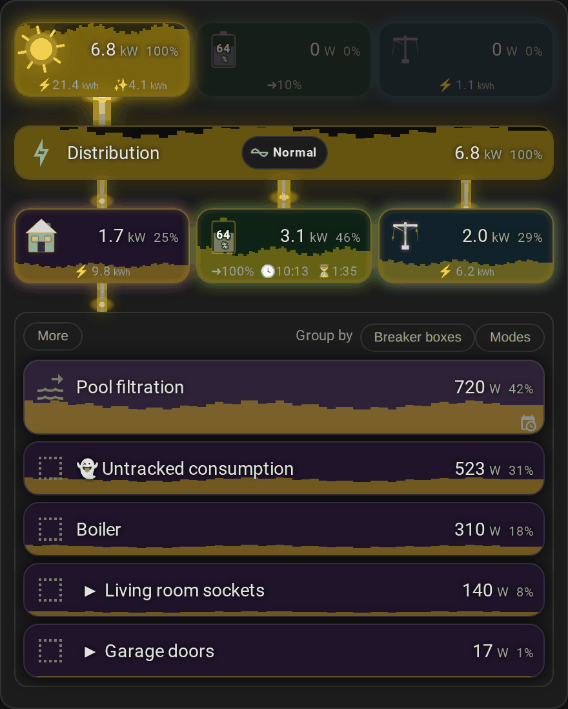
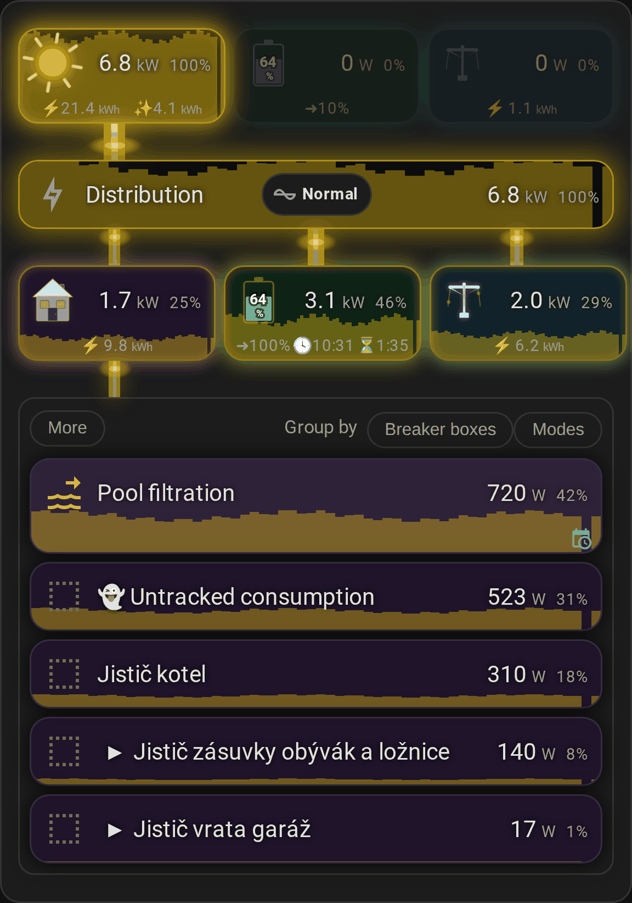

# Energy flow card

`custom:helman-card` is the main view: where power comes from and where it goes, right now.

{ .shot }
{ .shot }

## Reading it

- **Top row: sources.** Solar, battery and grid as they *supply* power. A source that is not supplying is dimmed. The battery tile shows the SoC it may discharge to and, while discharging, the time left. The solar tile shows today's production (⚡) and the forecast still to come today (✨).
- **Middle bar: distribution.** The total power flowing, with the inverter's current mode in the middle (*Normal* in the picture).
- **Second row: consumers.** House, battery and grid as they *take* power: the house consuming, the battery charging (with its target and time to full), the grid receiving export. The percentages split the total between them.
- **The house tree.** Every device in the house, largest first. A row with ▸ has children, so tap it to open them. Each row's background bars are its power over the last few minutes, coloured by the source that fed the house at the time.
- **👻 Untracked consumption.** The part of a meter's reading its children do not explain. In the house, it is everything not on a sub-meter.
- **Badges.** A calendar icon marks a device Helman schedules. Group badges (🔋, ⏻😴…) show which [groups](../devices/groupings.md) a device belongs to.

## Doing things

- **Tap an icon** (sun, battery, pylon, house, a device's icon) to open its [node detail](node-details.md).
- **Tap a row** to open or close its children.
- **More** shows the devices beyond the first few.
- **Group by** re-files the tree by one of your [groupings](../devices/groupings.md), for example by breaker box. Children assigned to a different group than their parent move to that group, and the parent's power drops accordingly, so the group totals add up.

## Why the numbers add up

A device with children shows its **own meter**, which already includes the children. Helman does not sum children into the parent; it subtracts them to compute *untracked consumption*. A device without a meter of its own, for example one of four air conditioners behind a shared breaker meter, gets an **estimated** share of that meter, based on its learned power. It is marked as estimated wherever it appears. See [The Helman device](../concepts/devices.md#power-for-devices-without-a-meter).
