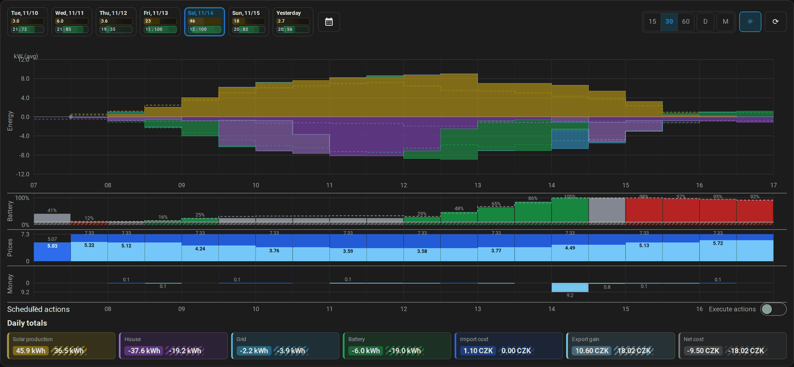
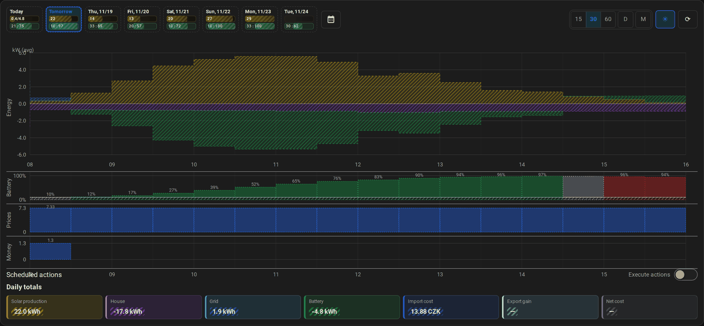

# Inspector

`custom:helman-solar-inspector-card` shows one day at a time on a shared time axis. For a past day it shows what happened. For today and the days ahead it shows what is planned. Give it a full-width view.

{ .shot }

## Reading it, top to bottom

- **Day pills.** One pill per day. Each shows the day's solar (kWh) and the battery's lowest and highest SoC. Pick one to see that day. The calendar opens any date.
- **Energy chart.** Above zero: solar. Below zero: where energy went, meaning the house, battery charging and export. Solid areas are measured, dashed lines are what was forecast for them, and hatched areas are the forecast for slots still ahead. The blue line is *now*.
- **Battery.** The state of charge per slot: green charging, red discharging, grey idle.
- **Prices.** Import (dark) and export (light) price per slot.
- **Money.** What each slot cost or earned.
- **Scheduled actions.** The lanes of the [schedule](../concepts/schedule.md), with the **Execute actions** switch. Tap a lane to [edit it](schedule-editor.md).
- **Daily totals.** Solar, house, grid and battery energy and the money for the day: measured first, forecast beside it, striped.

{ .shot }

## Controls

- **15 / 30 / 60** set the slot width of the chart. **D** shows a month of days and **M** a year of months.
- **☀** crops the chart to the hours with sun.
- **⟳** reloads.
- Tap a slot for its detail: every value of that slot, and for solar, the correction factor applied.

## What it is good for

- **Checking the solar correction.** Compare the raw forecast, the corrected forecast and the actual production. A correction that works brings the dashed line onto the measured area.
- **Checking the plan.** Look at tomorrow: does the battery reach full? Does it fall to the reserve before the cheap night tariff? Are the appliances where you expect them?
- **Understanding a bill.** Pick a past day and read the money row and totals.

!!! info "Older days"
    Recorder keeps detailed history for a limited time. For days older than that, the inspector falls back to hourly statistics and says so. The archived forecast for those days cannot be recovered.

Card options, including hiding rows or limiting the chart to some series: [Card options](../reference/cards.md#inspector).
