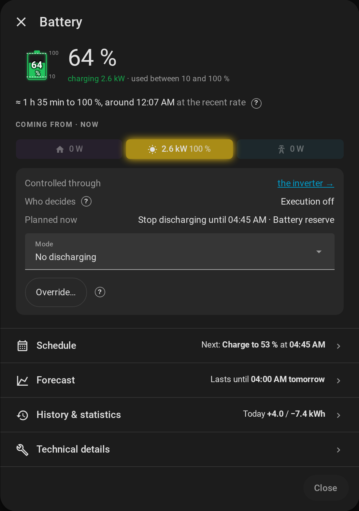
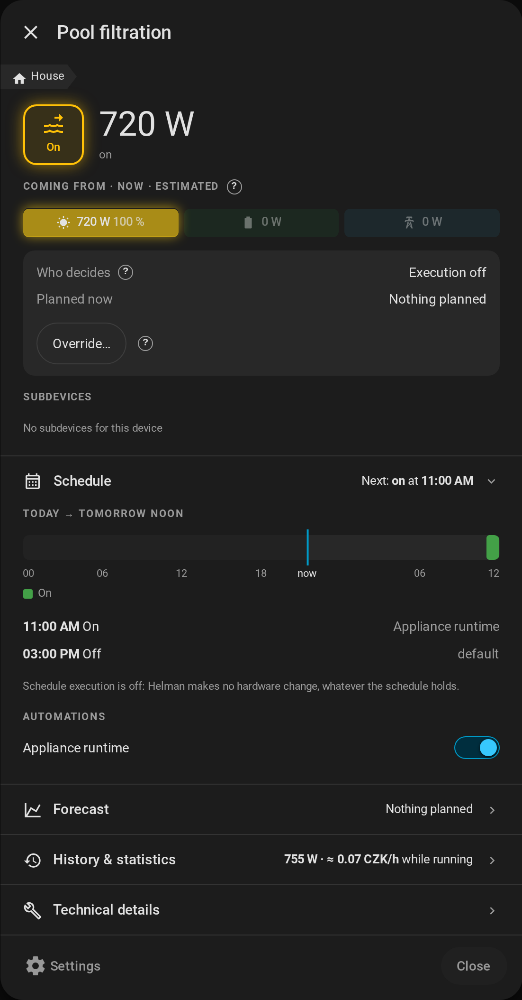

# Node details

Tap any icon on the flow card, or any device in the inspector or a report, and its **node detail** opens. Every node has the same layout, so once you know one you know them all:

1. **Headline**: the live value in large type, and what it means in words (*charging 3.1 kW · used between 10 and 100 %*).
2. **Coming from · now**: which sources feed it at this moment. For a device this is the house's current mix, marked as estimated.
3. **Controls**: what you can do here. Switch a device from its headline icon, and use the **control tile** of everything Helman controls (see [Switching by hand](#switching-by-hand)).
4. **Sections** that open on tap, each with a one-line summary so you rarely need to open them: **Schedule**, **Forecast**, **History & statistics**, **Technical details**.

{ .shot }
{ .shot }

## Per node

| Node | Headline | Worth knowing |
| --- | --- | --- |
| **Solar** | Production now | Forecast section: the corrected forecast against production so far, and the live day ratio |
| **Battery** | State of charge | Time to full or empty *at the recent rate*. The plan-based estimate is in Forecast. The battery is controlled through the inverter: its control tile is the inverter's, with the inverter's mode picker and a link to the inverter |
| **Grid** | Import or export now | Per-phase bars when phase sensors exist; prices and planned import/export in Forecast |
| **House** | Consumption now | The largest subdevices as bars; the forecast with planned appliance runs drawn on it |
| **Inverter** | Power through the inverter, with its load against the rated power | Two gauges: what flows into it (solar, battery, grid charging the battery) and out of it (house, battery, grid). The control tile adds *Inverter reports* (✓ when the registers match the last command, ✗ when not) and its mode picker: one segmented bar for up to three modes, a dropdown for more. The full *Did the inverter do what the plan asked?* chain (Plan → Helman sent → Inverter reports) is in Technical details, above the register table; Technical details is shown to admins only |
| **Device** | Power now | A breadcrumb back to its parent, subdevices, the switch, its schedule and its learned usage |
| **EV charger** | Charging state | Connection, car SoC and limit, the charging mode in its control tile, and the charging ledger in History |

{ .shot }
{ .shot }

## Switching by hand

Tapping a device's switch tile switches it right away. That holds **until the next planned change**, then the schedule takes over again.

Everything Helman controls (the inverter, the battery through it, the EV charger and each scheduled device) has a **control tile** on its Overview:

- **Who decides**: Helman's schedule, you until a time, or why nothing is applied (execution off, automation off, not automated).
- **Planned now**: what the plan has it doing and who set it.
- The node's own control: the inverter's mode as a dropdown, the EV charging mode as a segmented bar (up to three choices show as a bar, more as a dropdown). A mode picked here is written at once and holds until Helman's next planned window. While a plan window sets the EV mode, the bar is locked and says until when.
- **Override…** opens the [schedule editor](schedule-editor.md) for just this device, to keep a manual state for a range you pick.
- **Return to plan** appears while your override is running and hands the rest of it back to the automation.

A device that drives several lanes, like one meter shared by two pumps, gets one control tile per lane, each titled with its lane's name. The **Schedule** section shows only the plan: the strip, the coming changes, the execution note and the automations.

## History & statistics

For a device, this section shows what it used over a period you pick, where that energy came from (solar, battery, grid) and what it cost, from the same data as the [device reports](device-reports.md). Money is an estimate from the prices Helman knows, not your bill.
