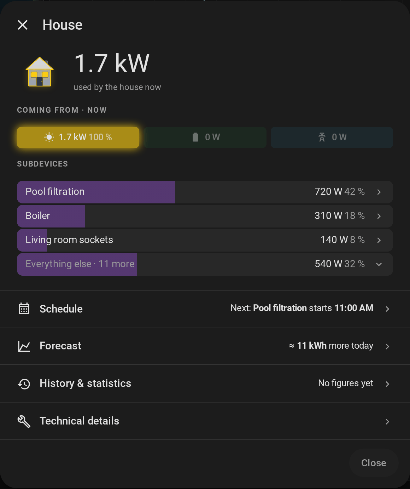
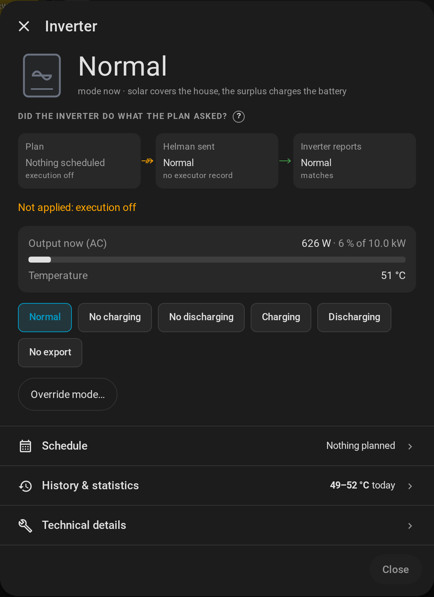

# Node details

Tap any icon on the flow card, or any device in the inspector or a report, and its **node detail** opens. Every node has the same layout, so once you know one you know them all:

1. **Headline**: the live value in large type, and what it means in words (*charging 3.1 kW · used between 10 and 100 %*).
2. **Coming from · now**: which sources feed it at this moment. For a device this is the house's current mix, marked as estimated.
3. **Controls**: what you can do here. Switch a device, change the EV charging mode, override the schedule.
4. **Sections** that open on tap, each with a one-line summary so you rarely need to open them: **Schedule**, **Forecast**, **History & statistics**, **Technical details**.

{ .shot }
{ .shot }

## Per node

| Node | Headline | Worth knowing |
| --- | --- | --- |
| **Solar** | Production now | Forecast section: the corrected forecast against production so far, and the live day ratio |
| **Battery** | State of charge | Time to full or empty *at the recent rate*. The plan-based estimate is in Forecast. The battery's schedule is the inverter's |
| **Grid** | Import or export now | Per-phase bars when phase sensors exist; prices and planned import/export in Forecast |
| **House** | Consumption now | The largest subdevices as bars; the forecast with planned appliance runs drawn on it |
| **Inverter** | Current mode | *Did the inverter do what the plan asked?* Plan → Helman sent → Inverter reports. Mode buttons for a manual override |
| **Device** | Power now | A breadcrumb back to its parent, subdevices, the switch, its schedule and its learned usage |
| **EV charger** | Charging state | Connection, car SoC and limit, mode control, and the charging ledger in History |

{ .shot }
{ .shot }

## Switching by hand

Tapping a device's switch tile switches it right away. That holds **until the next planned change**, then the schedule takes over again. To keep a manual state for longer, use **Override…**, which opens the [schedule editor](schedule-editor.md) for just this device.

## History & statistics

For a device, this section shows what it used over a period you pick, where that energy came from (solar, battery, grid) and what it cost, from the same data as the [device reports](device-reports.md). Money is an estimate from the prices Helman knows, not your bill.
