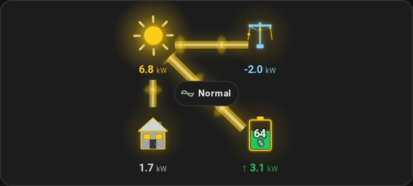

# Other cards

## Simple card

`custom:helman-simple-card` shows solar, grid, house and battery as a small diagram with the flows between them and the inverter's mode. It needs no configuration and fits a wall tablet or a phone.

{ .shot .shot--narrow }

## Device card

`custom:helman-device-card` is a tile for one device or one energy node, with fields you choose, for example connection, mode, power and today's energy for an EV charger. It can hide fields while the device is idle. Tapping it opens the [node detail](node-details.md).

{ .shot .shot--narrow }

```yaml
type: custom:helman-device-card
device: sensor.ev_charger_energy_total   # the device's energy entity
fields: [connection, mode, power, energy_today]
hide_when_idle: [power, energy_today]
```

All options: [Card options](../reference/cards.md).
