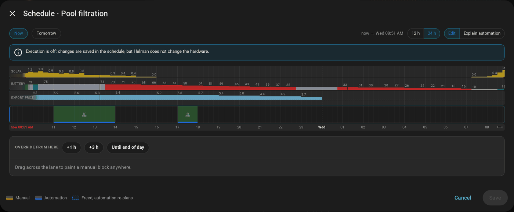
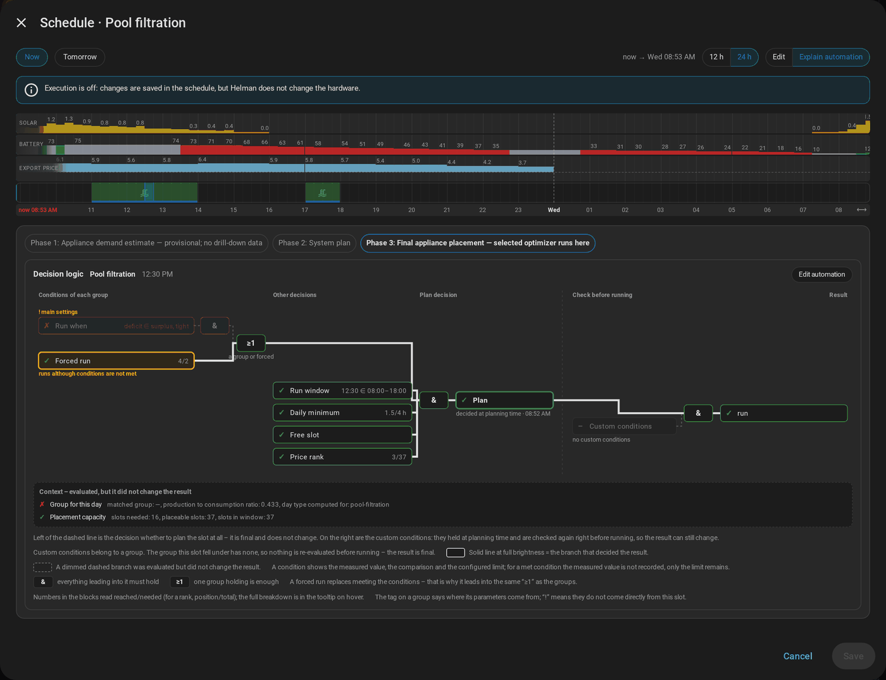

# Editing the schedule

Open the schedule editor from **Override…** in a node detail, or by tapping a lane in the inspector. It shows the next 12 or 24 hours of one lane over the solar forecast, the battery projection and the export price, so you see what your edit does before you save it.

{ .shot }

## Override a slot

- **Override from here**: *+1 h*, *+3 h* or *Until end of day* starts a manual block now.
- **Paint a block**: drag across the lane to paint a manual block anywhere, then pick its action. For the inverter that is a mode (and a target SoC for charging). For an appliance it is on or off, or a mode or vehicle.
- **Override an automation block**: tap a blue block and choose **Override this range** to put a manual action there instead.
- **Delete a block**: tap your manual block and **Delete** it. Its slots go back to the optimizers and are drawn as *Freed, automation re-plans* until you save.

**Save** writes the change and Helman re-plans immediately. **Cancel** leaves everything as it was. Your manual actions are never changed by an optimizer: they stay until they pass or you remove them.

!!! warning "Execution"
    With **Execute actions** off, saved changes stay in the schedule, but Helman does not touch the hardware. The editor says so at the top.

## Explain automation

Switch the editor to **Explain automation** and tap any slot. Helman shows the decision of the optimizer that owns the lane:

{ .shot }

Read it left to right:

1. **Conditions of each group.** Every [condition group](../automation/condition-groups.md) with each of its conditions, met (✓) or not (✗), with the measured value against the limit. One group holding is enough (≥1).
2. **Other decisions.** The optimizer's own checks, for example *is the slot in the run window*, *is the daily minimum still unmet*, *where does this slot rank by price*.
3. **Plan decision.** All of the above combined: plan the slot or not. This was decided at planning time and does not change until the next run.
4. **Check before running.** The group's [custom conditions](../automation/condition-groups.md#custom-conditions), checked again just before the slot executes.
5. **Result.** Run, don't run, or *candidate*: planned, but waiting for a custom condition.

Solid bright lines are the branch that decided the result. Dimmed dashed branches were evaluated but did not matter. Hover any block for the numbers behind it.

In the example above, the day was a *deficit* day, so *Run when* failed. The pool filtration ran anyway, because it had already skipped the allowed number of days in a row: a **forced run**. See [Appliance runtime](../automation/appliance-runtime.md#daily-minimum-and-skipped-days).

The **phase** tabs at the top show the three steps of a run (see [how a run plans](../automation.md)): appliances estimate their demand, the battery plans against it, and appliances are placed for real. The final placement is in phase 3.

**Edit automation** opens the optimizer's settings in place.
